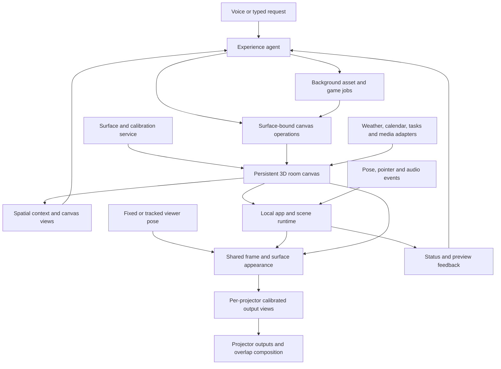

# Projection Mapper: agent, content, and canvas architecture

## Cloud projection inbox — October 27, 2026

An optional MCP relay accepts task-update data or natural-language visual requests from an authorized cloud client. It owns a bounded durable job queue, not a copy of the room or an additional projection agent. A local outbound receiver binds to one explicitly chosen Studio and sends work through the existing chat controller and room lock. Manual and cloud work share the same current canvas, completion review and supported capabilities. Idle polling does not invoke a model.

The relay exposes five MCP tools: publish_task_update, request_projection, get_projection_request, get_projector_status and cancel_projection_request. Separate submit/device credentials protect Streamable HTTP and a local stdio proxy; HTTPS is required for remote receiver connections. Stable event IDs deduplicate retries, delivery deadlines expire stale updates, and a private local receipt journal retries acknowledgements without replaying scene edits. Interrupted executions become uncertain and require inspection rather than automatic resubmission. Queue acceptance, agent completion and physically verified projection remain distinct; cloud receipts always report projectionVerified:false.

This implementation is single-installation/single-process with persistent disk, bounded retention and explicit local receiver opt-in. ChatGPT/Codex can reach the private stdio proxy through an account-configured OpenAI Secure MCP Tunnel; a public relay is unnecessary for that local prototype. Public clients requiring OAuth need a gateway/adapter. A local tunnel requires the computer online to accept new requests; durable queuing begins only after inbox acceptance. MCP does not itself add new image/video generation, scheduling or hardware capability. See [cloud connection setup and limits](agent/CLOUD_PROJECTION.md) and [ChatGPT/Codex account setup](agent/CHATGPT_CONNECTION.md).

## Implemented agent layer — October 18, 2026

The shared canvas remains authoritative. The agent has typed tools for implemented scene controls (layout, layers, media presentation, display, selection and explicit alignment/geometry edits), plus a host-owned Studio port for navigation, playback/output, imports, saved compositions and sensor controls. File/account/browser-permission steps report a user handoff. Retired effects and direct game-score injection remain unavailable. Measured fixed-rig solving, explicit selected-object controls and bounded generated 2D programs have separate contracts; body/touch tracking, automatic object recognition and unimplemented services are not implied by interface parity.

Context refreshes each model step with relevant scene details and tool groups; on-demand inspection/selection unlocks the complete implemented interface. The full host exposes 38 tools / 32 canonical scene command types plus dedicated Studio program and mapping operations. A bounded local learning store persists explicit preferences and tentative examples from completed manual adjustments, with room/activity/surface scope, geometry revisions, editable/forgettable records and a learning switch. Calibration remains authoritative setup state, never an inferred aesthetic preference. This is retrieval-based adaptation, not reinforcement learning or weight training. Chat history is separate and bounded; old screenshot bytes are discarded from subsequent turns.

## Original generated programs — first slice

Agent tools now author/revise/test/apply/inspect/configure/rollback original Projection SDK1 programs. The canvas owner supplies the QuickJS worker interpreter, artifact store, test runner, painter and normalized pointer/keyboard input. Programs express JSON state and bounded 2D primitives through `init`, `update`, `draw`; they cannot access native/app APIs, the network, files or arbitrary browser code. Numeric parameters support immediate follow-up edits without regeneration. The model writes code and evaluates test feedback; it does not run a model call for each frame.

Authored code is first tested away from live content, including deterministic input replays and state assertions. Actual runtime reports and available rendered samples return to the model, with up to three test attempts per request. Only a passing host-held token bound to source/surface/scene/geometry can be applied, at the tested scene revision. The completion review cannot cite an authored or tested candidate as evidence of deployment. New/revised code starts paused; explicit start follows requested animation or gameplay. Parameter patches preserve state; code replacement and rollback reset/pause, retain the same content identity/placement/layers and preserve working versions. Existing surface clipping remains intrinsic to rendering.

This implements original local procedural 2D visuals and pointer/keyboard games, not generated images/video, textures, 3D worlds or Kinect gameplay. The agent can depict stylized subjects with primitives when appropriate, while photographic/cinematic asset requests remain explicit missing capabilities. Physical object identity, curved masks and tracking belong to the separate hardware workflow below; generated programs cannot attach themselves to tracked objects. Validation and activation status are tracked in `coordination/agent-status.md` and the canvas owner's status; compiled code alone does not establish live-runtime activation or physical output quality.

## Retained room reference and reconnect recovery

The canvas owns one stable metric room reference, separate from ephemeral live frames. `operate_studio` exposes hardware `scan-room` and explicit `forget-room`; `inspect_studio` reports `roomModel` with readiness, reference/sensor IDs, sample counts and `canMap`. A scan saves a temporal consensus of measured points. It does not solve projector calibration or recognize named objects. The canvas requires fresh compatible observations after reconnect, and retains the saved reference while the stream is missing. Forget/reset is a user-requested operation, not an automatic recovery strategy.

New physical `fill_surface` actions require a live sensor, a ready reference with `canMap`, matching sensor/reference IDs and membership in the canvas's current `validSurfaceIds`. Surface measurements carry `roomReferenceId`; old unanchored or retired fits stay visible but cannot authorize a new physical fill. Clearing color remains possible offline. The host rechecks eligibility at dispatch rather than relying solely on an earlier model inspection. These are software validity checks, not an optical guarantee that the projector stayed aligned.

Helper capture/relay failures use bounded retries and an explicit ordered waiting boundary before a restarted stream's sequence zero. Retired sources cannot send new frames/statuses into the current acquisition. The receiver clears ephemeral frames and aborts an interrupted pattern capture; it must not combine observations across that boundary. No protocol epoch/mapping-revision extension is introduced in this slice. The Windows sensor and physical USB recovery still require rig qualification.

This design follows the distinction between [Kinect availability/device identity](https://learn.microsoft.com/en-us/previous-versions/windows/kinect/dn758761(v=ieb.10)) and [SDK camera-space coordinate mapping](https://github.com/Kinect/Docs/blob/master/Kinect4Windows2.0/k4w2/Programming_Guide/Coordinate_mapping.md). Camera-space meters are not a sensor-to-projector calibration. Microsoft also exposes [coordinate-mapping changes](https://learn.microsoft.com/en-us/previous-versions/windows/kinect/dn758445(v=ieb.10)); a future explicit mapping revision should invalidate dependent calibration. The current room comparison can reject observed geometry shifts, but is not a substitute for that event. Fixed mounting reduces relative motion; it neither establishes calibration nor detects projector-only changes.

The bounded temporal reference deliberately precedes general reconstruction and semantic object selection. [PCL plane segmentation](https://pointclouds.org/documentation/tutorials/planar_segmentation.html) estimates geometric inliers, while [Open3D TSDF integration](https://www.open3d.org/docs/latest/tutorial/t_reconstruction_system/integration.html) consumes camera poses. Neither alone supplies named-object identity or calibrated projector visibility. Implementation/validation status is recorded in the owner notes.

## Physical object request: “turn the Clorox cylinder red”

Named-object identity must be grounded in an actual camera observation or a user selection. The selected-object prototype initially used a human click in registered RGB; the mapping workshop below adds agent inspection and selection of an unambiguous measured candidate. This is not a dedicated brand detector or identity guarantee. The existing `fill_surface` still operates only on planes and must never substitute a red table, rectangle or renamed asset for an object. Per-surface measured/simulated provenance remains in routine context; dense mask pixels stay with the renderer.

### Selected-object prototype — published

The shared Studio contract adds hardware `calibrate-projector`, `fill-object {objectId,color}` and `stop-object` through existing `operate_studio`, with `objectMapping` inspection for calibration, selected ID, tracking status, point count, speed, source age and `canFill`. No extra scene asset or surface is created. Calibration estimates a 3D projector fit from nonplanar Gray-code/XYZ correspondences, rejects inadequate geometry and uses held-out residual checks. Its lifetime is the current Hardware session; a reload requires fresh calibration. A measured tabletop in the same room is required for selection. There is no arbitrary agent seed-coordinate API; newer candidate selection uses a measured observation token as described below.

Non-null color requires the exact current selected ID, a present calibration, live acquisition and tracking/canFill. The agent checks before issuing the command and the host revalidates at application. The local renderer owns frame-by-frame masks and loss blanking. Active object color exclusively replaces the projector image with a black-backed measured mask; the existing scene is retained. A lost/stale colored target stays black until explicit `color:null` restores scene output or `stop-object` additionally removes selection/region. Both clear paths remain available offline. Receipts describe configured color/calibration estimates, never optically verified projection.

The canvas owner's initial software limits are one connected observed shape above 3 cm from its support plane, a fixed 36% × 36% image region and 15 cm/s motion, with bounded source-age, output-expiry and continuity watchdogs. The existing helper processes at most 5 frames/s. These are implementation limits, not measured latency, tracking quality or physical alignment guarantees. The [curved-object guide](CURVED_OBJECTS_V1.md) documents current timing bounds and physical setup. There is no hidden-face reconstruction, complete 6DOF pose, fast/unbounded motion, automatic reacquisition, generated texture/video material or brand recognition. Agent schemas, context and tests cover this boundary; integrated root/browser/physical validation status remains in the owner notes.

### Agent-guided mapping workshop — implementation and integration checks

The optional `StudioPort.observeMapping` exposes one paired registered RGB/depth frame plus a computed candidate overlay and projector-mask preview. `inspect_object_mapping` passes those individually labeled images to the model, alongside candidate IDs, contours, bounding regions, measured centers/extents, current settings, mask scale, sensor/room/calibration identity and freshness. Physical camera images and derived masks remain distinct; `inspect_visual` continues to mean the rendered canvas. Camera-visible text is untrusted content. Image bytes are bounded and removed from later-turn history; old images must not authorize new changes.

`refine_object_mapping` dispatches host-owned `mapping.select`, `mapping.refine`, `mapping.undo` and `mapping.reset`. Every edit requires the latest current-turn observation token, its exact revision and a returned candidate or selected object ID. The host independently checks its 15-second observation lease, current source freshness, geometry/identity continuity and tracking/output conditions. Source age and clock uncertainty are separate values; their conservative sum is checked once. Selection starts without color and never substitutes a filled bounding rectangle for the measured component.

Refinement supports inset of 1–8 projector-mask cells, inward feather of 0–8 cells, and left/top/right/bottom trim margins of 0–30% of the measured camera bounds. The object remains locally tracked; trims follow its observed bounds. Unspecified settings, color, calibration and unrelated content remain unchanged. Undo restores prior edge settings; reset restores the default inset, hard edge and zero trims. No arbitrary translation, dilation into unknown geometry or relaxation of occlusion guards is exposed. These limits permit tightening/softening and cropping edges, not correcting every physical calibration error.

The agent uses an inspect-adjust-inspect loop, limited to four dispatched edits and six inspections per request. Accepted edits force another observation; the returned mapping revision/object/settings must match before the turn can report a completed comparison. Missing post-edit evidence leaves the request incomplete while preserving the accepted change. Review groups inspections and preservation constraints with the actual edit, so it neither invents another mutation nor loops trying to prove a read-only inspection with a new action. Physical alignment remains unverified; there is no automatic optical-error score or claim of an optimal real-world result. User feedback can guide further bounded iterations. The [object mapping workshop guide](OBJECT_MAPPING_WORKSHOP.md) covers setup and controls; current validation/publication status is recorded in the owner notes.

Beyond these bounded prototypes, the complete cylinder interaction requires:

1. **Identify a specific object.** Use `inspect_object_mapping` for a time-stamped camera image and measured candidates, then select the intended candidate only when visible identity/location is unambiguous. Request a user click/identification otherwise. `inspect_visual` is a rendered canvas image and cannot do this. Registered 512×424 RGB is useful for geometry; small-label recognition may need the original higher-resolution RGB with its SDK correspondence, not a guessed upscale.
2. **Measure its visible shape and projector coverage.** Segment object points from the support plane and background; preserve occlusions, holes, invalid depth and uncertain edges. Use a conservative measured mesh or point mask, with a cylinder fit only when the observed points support it. Camera-visible does not imply projector-visible. The dense Gray-code pixel correspondences retained by the canvas solver can support an initial stationary-object mask. A table homography cannot map a curved container or new object positions; moving-object projection requires a calibrated 3D projector model or an equivalent validated geometric mapping.
3. **Assign an editable material.** A solid-red request is a material/color parameter attached to the measured object. Patterns, textures and procedural animation can use the same object attachment later. AI-generated video is an optional material source, not a prerequisite for a solid fill. Follow-up requests change material parameters without rebuilding the object geometry or generating a new video.
4. **Render and track locally.** The agent chooses the target, material and tracking policy. Local perception updates pose/mask and the renderer projects the latest valid state. Every update needs sensor/clock/calibration provenance and confidence. When the object is lost, occluded, ambiguous or too stale, suppress its projection instead of painting an old outline or selecting another similar object. The current 5-processed-fps helper is for calibration acquisition, not a promised tracking rate.
5. **Verify separately.** Measure static spill/alignment and then movement latency on the real Kinect/projector setup. Report confidence, last observation and tracking status to the agent so it can accurately distinguish “material configured,” “tracking active,” and “physical result checked.” Save object definitions/materials with calibration revision; do not persist a stale live pose as evidence of current tracking.

Begin physical qualification with one stationary, opaque, clearly visible container and conservative clipping. Qualify small movements afterward, then generalize recognition, multiple objects and more complex materials. The agreed selected-object contract above does not establish automatic identity or broad tracking proficiency.

Projection changes illumination rather than the physical pigment. Existing label colors, ambient light, gloss, shadows and projector visibility limit the achievable result; a saturated printed container may not look uniformly red. Geometric mapping and measured color compensation are separate. Relevant precedents are [Shader Lamps](https://www.merl.com/publications/TR2001-21), [Dynamic Shader Lamps](https://www.merl.com/publications/TR2001-50), and [radiometric compensation](https://www.cs.columbia.edu/CAVE/publications/pdfs/Nayar_PROCAMS03.pdf). These establish useful techniques, not evidence that the current app or hardware achieves them.

Whole-request orchestration now tracks requested outcomes through a structured review. Successful action receipts are required for completed items; unsupported assets and user handoffs remain explicit. An early model stop resumes pending work under one shared step/time budget, without replaying accepted changes. The user sees deterministic accepted edits plus unresolved requirements. Intent coverage remains a model judgment, and supported rendering/asset capabilities remain distinct from tool orchestration.

The agent can request at most two actual rendered surface previews per turn, with scene revision, timestamp, runtime readiness and limitations. Fresh images reach the model as image input; stale/missing images do not establish visual success. Previews are software renders, not physical-camera evidence. Local code still handles all continuous video/color/sensor processing.

Six adaptable built-in experiences use the existing content library and revision-checked atomic scene batches: underwater, ambient art, cinema, music, cooking and tabletop game. They preserve unrelated panels and geometry. User-approved custom arrangements live in the canvas-owned composition library. No media or asset identity is fabricated; search/import/runtime readiness retain their existing provenance rules.

See [agent guide](agent/README.md), [host integration](agent/INTEGRATION.md) and [current coordination status](coordination/agent-status.md) for APIs, validation and activation. The product architecture below includes future capabilities; this implementation note defines the current agent scope and supersedes older statements that alignment, layer/display/media controls or visual inspection are UI-only.


This is a proposed design for the user's expanded first prototype. It records the intended product and implementation boundaries; it does not claim these features are implemented or hardware-tested.

The built-in matrix/ripple line demo is permanently retired at the user's request. Legacy scene effect fields remain disabled for save compatibility, with no renderer/UI or agent enable path. The agent no longer exposes `set_effect` or allows `effect.set`; it must not recreate the removed demo as artwork. User-created artwork and video backlighting remain distinct supported content.

Implementation updates are tracked in [coordination](coordination/README.md). The 2026-10-13 [YouTube/backlight work](coordination/youtube.md) implements supplied-video placement, topic search and default-on dynamic backlighting. A private native worker supplies official-player frames to the existing local website and calibrated renderer without screen sharing. Browser iframe capture remains an optional fallback. The agent selects content and backlight policy; per-frame colors remain local. Physical projection and additional streaming providers remain unverified.

The FREEkMapper integration adds user-uploaded local media and per-item layers/display settings through the canvas interface. File bytes remain in local asset storage; the agent sees only asset references and metadata. Existing tools can rename/move/remove an uploaded item and request start/pause/reset for an uploaded video. Upload, source replacement, seeking, layer changes and display settings remain interface operations. Read-only context includes effective visibility and blackout settings, so a successful content edit is not confused with verified projection. Asset presence, decoded playback and audio require runtime evidence beyond a saved scene. Integration rendering and release checks are tracked separately by the integration owner.

**Current quality redesign:** source playback works, but the user rejected dominant-color blobs that put interior reds next to a dark blue video border. The revised effect must begin with adjacent edge colors and blend smoothly into wider ambient light. Canonical tone profiles are Cinema (default), Vivid, Soft and Natural. The existing OpenAI agent selects `toneProfile` through `configure_video_backlight`, alongside brightness/spread/smoothing/on-off controls. Continuous sampling, blending and adaptive tone mapping run locally without model calls. This is AI-selected policy, not a neural per-frame tone mapper; no pixels are sent to the AI. Renderer validation is tracked in the canvas status and supersedes the earlier source-only milestone below.

**Reusable effects direction:** keep the existing AI agent and expose persistent effect configuration through tools. A tool call starts or changes a local process that continues across frames, rather than requiring another model call for every frame. Separate reusable color-space/tone operations from the backlight's edge sampling/diffusion and the calibrated canvas compositor. Future video, artwork or other effects can reuse the color operations with their own sampling and composition rules. A skill can describe when to use effects, but does not replace the executing tool/runtime. Backlight is an independent component inside this engine, not a second app, scene store or agent. A future learned local model can be added at the processing boundary; none is implied by the current adaptive math.

**Room fill and strength controls:** the same video effect now exposes independent opacity, vibrance and continuous room fill. Room fill ranges from a normal halo at 0 to immersive illumination across all room surfaces at 1; it changes reach separately from brightness or blend strength. The existing scene geometry maps one video-derived field onto wall, table and other surfaces. Timers and foreground panels remain clear through compositor masks, and native surface boundaries/exclusions remain authoritative. No duplicate players, generated artwork or asset slots are required. The existing agent tool accepts these settings from conversation, preserves unrelated values and leaves deleted art removed. Rendering validation and release status remain in the coordination notes.

YouTube topic discovery is now implemented through `search_youtube`: a bounded OpenAI hosted search finds actual YouTube source links, and official oEmbed metadata supplies title/channel information. The agent selects a relevant returned candidate and places it through the same canvas tool, with backlight enabled by default. Supplied links still work directly. Runtime provenance checks prevent invented video IDs from reaching display/replacement; metadata and playback verification remain distinct. This adds no search key, scene schema or alternate renderer.

**Earlier native-only implementation checks:** the canvas task has built one sandboxed offscreen 1920×1080 Electron source per YouTube content ID, using the official embed. A capped 15 fps CPU bitmap/JPEG latest-frame transport supplies video and matching spatial colors to the existing surface, 3D, manual and projector compositors. It uses neither screen sharing nor app-window capture. Silent Electron checks verified source frame/color delivery, identity retention, mute gating, calibrated pointer delivery and cleanup. Native input maps through the inverse calibrated video plane to keep official controls usable; the old desktop capture IPC/preload endpoint is removed. A receiver/painter harness showed matching blue/orange gradients outside an unchanged decoded image, disappearing when disabled. Official YouTube startup reached Ready, paused and muted, with six poster frames and no Play action. **Moving YouTube video/backlight and physical projection remain unverified during the user's Zoom call.** Agent schemas/commands are unchanged; guidance distinguishes native and browser paths without claiming verified playback. New browser/native sources start paused and muted; no Play tests in the user's live room.

The existing source inspected for this design implements a timer-oriented scene model with one manually aligned quadrilateral, a command reducer, and operator/output windows. The new design generalizes that foundation. It supersedes the earlier blueprint's narrower content scope and its deferral of all generated games.

**Latest live-site implementation:** the user’s existing localhost site is connected to a private native worker through Vite/browser transport, retaining its browser scene and unchanged agent interfaces. Canvas owner verified actual I5QMtbO-DNk playing muted without sharing, with same paused-frame on/off screenshots showing red lower-left, tan right and blue above outside the video. Fish remains. Final verification passed: 85 root and 60 agent tests/build, host PID66318 with the 63.6 KB agent bundle, Scene358 / Geometry5 preserved. Actual muted moving video and visible matching gradients work in Surface layout and the clean same-origin output; a read-only live AI check correctly described fish and YouTube without edits. No app switch is required; live site work/reload is authorized and audio remains muted. Ordinary agent artwork requests now reuse the surface’s existing background through content.update instead of attempting a second full-surface artwork.

## Product model

The user talks to an agent whose native workspace is a persistent 3D representation of the room, its projectable surfaces and the content already running. The agent creates experiences and manipulates objects directly through that workspace. The canvas continuously renders calibrated views for its active projectors.

**Design correction from user feedback:** Geometry and drawable boundaries are intrinsic to the canvas. Routine edits use surface-bound operations, without an agent proposal → placement review → agent correction cycle. Newly generated assets and games may require background preparation, but existing scene edits must have a direct local path.

The canvas is a room scene graph with world transforms, named objects, surface geometry, relationships, projector visibility and persistent content. A table owns its drawable tabletop; content attached to that tabletop inherits its coordinate frame, usable region and projection mapping. The room representation can be 3D even when its initial drawable surfaces are planar. Mock geometry must be marked simulated until measured.

**Spatial-canvas requirement:** Content is authored and arranged against the room's calibrated geometry and boundaries inside this shared canvas. Each projector is an output view of that canvas. Adding another projector must not create another copy of the experience or change where its objects live. The viewer's position is a separate input for experiences whose apparent depth depends on perspective. The current four-corner editor is an initial output adapter; it does not yet implement this 3D workspace.

The agent works through object handles, valid anchors, layout policies and surface-bound drawing/behavior operations. Calibration updates the same underlying spatial state. The canvas's implementation performs clipping and coordinate transforms continuously as part of drawing; those operations do not require another model invocation or a separate approval stage.

A richer representation gives the agent more useful spatial context. It does not guarantee that the model chooses the right object or understands every spatial relation. The constrained canvas bounds what its operations can draw, while feedback and evaluation address semantic errors. Latency and reliability improvements are design hypotheses to measure.

The requested first prototype includes every family below. Implementation order is a sequence of slices within that scope, not a reduction to one water demo.

| Capability | First-prototype experience | AI contribution | Local runtime / integration |
| --- | --- | --- | --- |
| Living surfaces | Water, glowing patterns, animated paintings, vines, stars, flowing materials | Generate art and textures; choose effects, palette, density and behavior | Reusable animation components, particles, image deformation and shaders; edge-aware effects use surface boundaries |
| Windows into worlds | Space through a door, an underwater window, a landscape inside a wall | Generate scenery and assets; assemble an environment | Masked scenic image/video or a rendered 3D view; explicit viewing position when perspective is part of the illusion |
| Interactive worlds | Movement-responsive creatures, a tabletop ecosystem, music-driven environments and simple games | Create entities, themes and behavior configurations | Entity simulation, input events, audio analysis, game state and collision rules |
| Custom generated motion games | A user describes an original dance, reach, pose-match or movement game | Generate rules, choreography, progression, instructions and visual assets | A validated game definition executed by a local game engine; pose and audio clocks drive scoring |
| Cooking timer | Multiple named timers with start, pause, resume and reset | Interpret intent and choose placement | Persistent deadlines and deterministic timing |
| Recipe display | Ingredients and step-by-step instructions, next/back and linked timers | Structure a provided recipe or generate a clearly identified recipe | Readable template, source information, step state and timer links |
| Weather report | Current conditions and forecast for a selected location | Select information and presentation | Weather provider adapter, units, location, observation/forecast timestamps and freshness |
| Calendar / to-do display | Upcoming events and tasks from connected accounts | Select relevant range, summarize and arrange | Authenticated read adapters, timezone-aware data, refresh state and optional user-entered local tasks |
| YouTube display | Play a supplied video link with pause, resume, seek and volume | Interpret requests and control the player | Official embedded player; a separate search adapter can be added when configured |

Calendar/task display does not imply permission to edit a person's accounts. Display and remote mutation are separate capabilities. Recipe, weather and calendar text is rendered as text, even when the surrounding artwork is generated.

## System and data flow



The canvas renders continuously on the Mac. Once a command reaches the local app, an existing-content edit updates canvas state directly. AI and provider jobs run asynchronously. Timers, motion scoring and animations continue without a model response. Local type, handle and capability checks still apply; they are not a language-model review loop.

An example request is: “Put an underwater window on the door, my recipe on the counter, and a ten-minute timer beside it.” The agent uses the actual door/counter handles and their available layouts. Surface-owned layout places the recipe and timer together inside the usable counter region, and the portal draws into the door's existing canvas. Available content appears immediately after command execution; missing assets/data load independently. Unreachable surfaces are marked unavailable in agent context and cannot supply active projection handles.

## Customized spatial AI layer

Build a domain-specific agent environment around an existing model first. Its core is shared spatial state and a surface-bound action interface. A specialized trained model is an option to evaluate later, not a prerequisite for constructing this workspace.

- **Room memory:** stable object IDs, positions/orientations, measured dimensions when available, boundaries, parent/child structure, adjacency, usable regions and projector coverage. Distinguish observed geometry, inferred labels/relationships and unknown areas.
- **Spatial queries:** resolve “the counter beside the door,” identify reachable surfaces and locate free regions using geometry queries. Return uncertainty for ambiguous labels instead of inventing a match.
- **Canvas-native actions:** attach content to a surface, fill a surface, follow an edge, anchor a panel, adjust a bounded parameter, or move along a surface path. Drawing operations inherit the selected surface's domain.
- **Visual context:** labeled room overview and on-demand camera, top-down, viewer and projector previews. Identify each view's pose, purpose and geometry revision. A free-orbit editor camera is not the human's viewing position. Structured geometry supplies coordinates and their measurement status; images help the model interpret appearance. Send changes and relevant views rather than every camera frame.
- **Persistent behavior:** agent-authored interactions execute locally from motion/audio events. Model reasoning changes goals, content and behavior parameters while the current scene remains active.

For example, `fill_surface(tabletop_handle, water_effect)` automatically uses that tabletop's drawable region. `follow_boundary(doorframe_handle, vine_effect)` uses the canvas boundary/path data. These are conceptual operations, not implemented APIs. Neither requires the model to regenerate pixel-space corners.

Object parenting and local/world transforms are established scene-graph mechanisms; see the [Three.js scene-graph explanation](https://threejs.org/manual/pages/scenegraph.html). Parenting alone does not clip child content. This design adds constrained surface domains and drawing rules to those mechanisms.

If evaluation later shows persistent errors in reference resolution, spatial composition or behavior authoring, collect examples of room context, desired actions and rendered outcomes. Those examples can guide model selection or fine-tuning. Merely supplying a 3D mesh or training a model is not a geometric containment guarantee.

## Geometry and boundaries

Maintain explicit coordinate spaces and named conversions:

1. **Room/world space:** one shared frame for physical objects and content. Use meters when measured, with a documented axis/handedness convention and frame revision. Mark assumed dimensions and unknown scale explicitly. A simulator can supply known virtual geometry without calling it measured room geometry.
2. **Sensor spaces:** RGB and depth cameras have their own optical frames, calibration and timestamps. Register observations into room space; image coordinates, depth points and estimated body landmarks are not interchangeable room coordinates.
3. **Surface space:** local geometry with a normal, boundary, holes and reserved regions, plus a mapping from content coordinates to the surface in room space. Normalized UV coordinates are useful for panels; physical distances are useful for effect scale and readable text. A rectangle within 0–1 bounds is not sufficient to establish containment in an irregular surface. Planar embeddings come first; a mesh embedding can extend the same contract.
4. **Viewer space:** a designated fixed or tracked eye position in room space, with timestamp, confidence and a policy for unavailable tracking. Keep the operator camera separate. Content declares whether it is attached to a physical surface or uses a viewer-dependent depth illusion.
5. **Projector space:** one calibrated view and actual output pixel domain per projector, including the active display viewport, output mode and any correction map. Record projector pose/intrinsics when solved; retain a planar homography adapter when that is all the calibration establishes. Account for display scaling, letterboxing and projector-side image changes.

A four-corner homography alone does not establish the table's metric dimensions, a complete projector pose, or the user's viewpoint. Migration from the current prototype must preserve those unknowns. Do not manufacture a physically calibrated room from the existing 2D quadrilateral.

Use these distinct records in the shared canvas:

| Record | Essential responsibility |
| --- | --- |
| `RoomScene` | Stable world frame, object hierarchy, geometry revision, shared simulation time and content instances |
| `Surface` | Physical geometry/boundaries, local-to-world embedding, usable regions, anchors, adjacency, observation provenance and uncertainty |
| `Projector` | Device/display identity, output viewport, calibration model, availability and output capabilities |
| `ProjectionCoverage` | A projector–surface relationship: reachable region, visibility/occlusion, mapping validity/error, masks and eventual blend contribution |
| `Viewer` | Fixed/tracked viewing pose, validity and the view-dependent experiences using it |
| `ContentInstance` | One persistent app/effect state, spatial attachment, target surfaces, rendering mode and supported actions |

A surface can be reached by several projectors and a projector can cover several surfaces. Physical boundaries, temporary obstacles, reserved UI areas and projector footprints remain distinct, even though the canvas combines them when computing drawable regions. Calibration status belongs to the relevant mapping/observation as well as any derived surface summary. Content ownership never depends on a particular projector ID.

The agent receives relevant records, grounded handles, available operations and labeled canvas views. It can reason about physical placement and ask for geometric queries without calculating optical transforms itself. This supplies spatial context; it does not guarantee that a language model understands a room correctly. Exact transforms remain available through queries, while raw point-cloud streaming is unnecessary for ordinary content operations.

Make constraints intrinsic at these points:

- **Surface creation/update:** construct its drawable domain, excluded regions, edge paths, layout anchors and projector mapping when calibration or geometry changes. Cache reusable spatial structures. Active content remains bound to the same stable object when its valid transform changes.
- **Content construction:** every projected drawing target requires a current surface handle. A panel inherits one surface's coordinates, boundary and layout policy. A room-owned effect has one state with an explicit set of valid target surfaces and shared world coordinates. Standard panels use surface-owned layouts; immersive effects fill/follow the selected geometry. Collision/edge behavior must also use the surface domains, so clipping is not the only thing preventing creatures from disappearing beyond an edge.
- **Direct edits:** execute an available surface operation atomically using current canvas state. Update the next renderable scene state without a model correction round trip. Outdated/malformed handles and impossible operations can still return local errors; constrained tools reduce these errors but do not eliminate changing-world races.
- **Drawing:** map the surface to projector space and enforce its drawable domain within the canvas render loop. Apply masks after effects that spread pixels, including blur/glow. Content cannot edit the physical boundary or bypass its output host. [Stencil/mask tests are graphics-pipeline operations](https://wikis.khronos.org/opengl/Stencil_Function), with a rendering cost to profile rather than another AI inference.
- **Geometry loss:** invalidate the affected mapping/coverage and blank its output contribution. Recompute the remaining valid coverage before issuing active drawing handles. Another projector may continue covering a region only through its own valid calibration; a failure of one projector must not automatically delete the surface or stop every output. If the surface geometry itself is lost, invalidate all dependent mappings and pause affected spatial interaction. Preserve app state, including timer deadlines, for recovery.

Use a configurable inset from measured edges to allow for calibration error. The inset is an engineering setting to tune using measurements, not an accuracy guarantee.

The enforceable digital guarantee is that submitted content cannot light pixels outside its current authorized output mask. Physical alignment still depends on correct, fresh calibration and optics. Undetected movement can create misalignment; projector black level and optical spill also prevent a claim of literally zero light beyond an object.

Initial geometry is stationary planar walls, tables, floors, counters and closed doors. Irregular outlines and excluded regions are useful even on flat planes. An opening door changes geometry and should invalidate its stationary mapping. Continuous moving-object tracking is a separate extension.

## Canvas composition and rendering

Use the persistent 3D room graph as the canvas itself, with a shared room theme and surface-local children. A world can use one palette and timeline while assigning different content to a wall, table and door. Spatial relationships are available across surfaces even when each surface uses a planar drawing path.

A content instance records its kind, spatial attachment, target surface IDs, accepted placement, layer order, configuration, persistent state, asset references, supported actions and resource requirements. A timer can be a child of one tabletop; a room-wide effect can be owned by the room with constrained participation on several surfaces. Give backgrounds, interactive experiences, utility panels and temporary overlays explicit layout roles.

For a coherent water effect spanning a wall and table, define one effect instance with a shared seed, scale, timeline and explicit surface adjacency/flow rules. Every output samples that same state. Decide whether an effect follows physical gravity, follows surface edges, or deliberately uses stylized behavior; the presence of a mesh alone supplies none of those rules. Independent wall/table UV textures can be useful, but do not by themselves establish continuity across their shared edge.

Utility panels reserve readable space or place a backing behind their text. Moving art should not silently obscure a timer or recipe. One selected audio source normally owns foreground audio; scene changes resolve audio ownership explicitly. Switching a background must not reset unrelated apps.

The proposed Electron/browser renderer has two compatible paths:

- **Graphics:** Canvas/WebGL, generated image assets, local video, scene effects and game visuals.
- **Panels:** Trusted HTML components for timers, recipes, weather, calendar/tasks and an official YouTube iframe.

Both paths use the same authoritative geometry and surface masks. For graphics, masking is the last rendering pass. For panels, the trusted output shell owns clipping and perspective transforms, including the wrapper around cross-origin embedded media. Validate clipping in the target Electron build. Embedded content must not escape into its own fullscreen window or picture-in-picture output.

An external iframe is not assumed to be available as pixels in a WebGL texture. Keep planar HTML composition as a supported path. General mesh mapping of arbitrary embedded media would need a separate supported rendering approach.

### Native media source and current acceptance

The user wants video to be actual canvas content and backlighting to work without sharing the screen. The implemented source is one sandboxed offscreen Electron renderer per YouTube content ID, owned by the trusted host and using the official embedded player at 1920×1080. A CPU bitmap/JPEG latest-frame transport is capped at 15 fps and supplies frames with matching spatial colors to the existing compositor. This is a configured cap, not a measured moving-video performance guarantee. The compositor applies the same placement, calibrated transforms, exclusions and outward edge gradients as other content. This is a media-source adapter for the existing room, not a second room model or an agent frame-rendering loop.

Source identity survives view/style changes, and removal/replacement follows content/source identity. The host owns cleanup and one shared source with controls for Play muted, Pause, Unmute, seek and reload. The WebContents is muted before navigation and every Play; reload/replacement begins paused and muted. Frame colors travel with their source image into the existing painter and output views. Silent integration validated source frame/color delivery, identity retention, mute gating and cleanup. Moving-video timing, cross-window presentation skew, protected media and physical projection remain acceptance work.

Newly created or replaced players start paused and muted. Play and unmute require deliberate operator action. Default-on backlighting configures the effect; it does not authorize autoplay or audio. Do not test Play on the user's active room during the Zoom call. Isolated validation must preserve this audio constraint.

Keep provider differences behind the source adapter so later supported streaming services can supply frames, controls and honest capability/error states through the same compositor. Official embeds and provider restrictions still apply: no direct stream extraction or protected-content bypass is implied, and a successful YouTube prototype does not establish support for other providers.

The browser preview remains a fallback with explicit same-studio-tab sharing. Its opened-player session now retains sharing through view, surface, source/configuration and backlight changes. Explicit Stop colors, final opened-player removal, page close/reload or development teardown releases it. Native sources instead follow host/content lifetime and must not depend on that browser sharing path. Native frame transport and controlled image/gradient on/off output are verified in silent harnesses; official YouTube startup is verified only through paused/muted poster frames. Actual muted moving YouTube and visible gradients are now verified in the localhost studio and clean same-origin output through the native worker. Physical projection, protected media and additional providers remain unverified.

The operator preview can show the 3D room, boundaries, diagnostics and controls. The projector window shows the current canvas through its calibrated output view. Geometry and content share object identity but have separate lifecycles, so recalibration does not discard app state or assets.

## Human viewpoint and apparent depth

Surface-attached content such as timers, painted patterns and many water effects stays fixed to the receiving geometry. A portal that appears to extend behind a doorway needs an explicit reference viewpoint. Define `surface_attached`, `fixed_viewer` and `tracked_viewer` rendering modes; the latter two remain pending until their calibration/tracking requirements are met.

For depth illusions, first determine the desired appearance from the designated viewer, then map that appearance onto the receiving surfaces through each projector's calibration. Merely rendering virtual objects from a projector camera does not establish the intended viewer perspective. Microsoft's [RoomAlive calibration/rendering explanation](https://github.com/microsoft/RoomAliveToolkit/blob/master/ProCamCalibration/README.md#how-does-projection-mapping-work) provides an established example of separate user-view and projector-view rendering.

An ordinary projected surface cannot generally show a different perspective-correct image to every viewer simultaneously. Start with a chosen viewing position, add one tracked viewer later, and use surface-attached effects when broad viewing tolerance is more useful. Changing the operator's orbit view must never silently change the nominated human viewpoint. A viewer preview estimates the geometry of the experience; actual brightness, surface reflectance, focus and ambient light require physical observation.

## Multiple projector outputs

Keep the data model and renderer interfaces ready for multiple outputs now; defer claiming physically seamless blending until measured with multiple projectors. The intended frame path is:

1. Advance content/game simulation once for the shared scene time and capture one scene/geometry revision for rendering.
2. Resolve the intended surface appearance, including any nominated viewer perspective. Reuse common assets, world coordinates, random seeds and animation phase.
3. For each projector, map visible receiving surfaces into its output viewport and apply its valid coverage, occlusion and boundary masks. Overlapping outputs refer to the same physical points.
4. Apply overlap weights and device response compensation in a defined color pipeline. Combine only valid contributors. In an ideal matched linear-light model their weights sum to one; this alone is not a physical brightness or color guarantee. Enforce the final authorized mask after processing that can spread pixels.
5. Present outputs against a shared target time and record timing skew. A shared simulation clock prevents separate game states, but does not synchronize independent display refresh or projector latency. Distributed clocks, presentation scheduling and hardware synchronization are later engineering work where measurements require them.

Geometry alignment, photometric matching and presentation timing are separate acceptance criteria. Measured brightness/color response, black level, incidence angle, resolution/focus and physical shadows can limit a blend. Software cannot subtract residual projector light. Resolume's [edge-blending documentation](https://www.resolume.com/support/en/edge-blending) illustrates the need for overlap alignment, blend shaping and black-level compensation beyond geometric warping.

Browser/Electron windows must render shared state rather than independently advance games or procedural simulations. Keep one audio owner. Declare output-path capabilities explicitly: local graphics may support overlap composition while a live cross-origin YouTube iframe does not automatically become a shared render texture. Until that path is demonstrated, give embedded media a suitable single-projector region or report the capability gap; do not promise arbitrary iframe content across blended outputs.

## Agent tool contract

These are proposed tools, not existing APIs. Expose a compact registry with schemas and capabilities; named convenience tools such as `show_youtube` can call the same underlying app operations.

| Tool | Purpose |
| --- | --- |
| `get_room_context()` | Read relevant room objects, relationships, usable regions, active surface handles, viewers, projector coverage, measurement status, content, selection and device/input capabilities |
| `query_space(reference, relation)` | Resolve spatial references and return grounded object handles, anchors, available regions or explicit ambiguity |
| `get_canvas_view(view)` | Obtain a labeled room/sensor/viewer/projector preview with its reference pose and scene/geometry revision |
| `list_content_types()` | Read app kinds, supported actions, layouts, input needs and configuration schemas |
| `generate_asset(brief, asset_type, style_reference)` | Start an asynchronous art/video asset job; return its job ID |
| `create_game_definition(brief, capabilities)` | Produce and validate a versioned game package using available mechanics |
| `mount_content(target_handles, kind, layout, config, request_id)` | Instantiate one content instance within one or more declared surface domains; use one target for a panel, or compatible targets for a shared room effect; return instance ID and loading/running state |
| `edit_canvas(operations, request_id)` | Apply available surface-bound operations as one local scene mutation |
| `get_job_status(job_id)` | Report readiness or failure of slower asset/game generation work |
| `control_content(instance_id, action, arguments, request_id)` | Pause, resize, change a parameter, advance a recipe, seek media or remove an instance |
| `save_experience(name)` / `load_experience(id)` | Save and recall a reusable composition; rebind/revalidate surfaces on recall |

Routine canvas edits do not require separate prepare/approve/activate tools. A timer mounts and starts in one operation. Expensive asset generation and game compilation are background jobs; when ready, their results attach to an existing surface-bound instance if that request is still current. Network data/media may remain loading after mounting.

Tool responses include actual accepted placement, scene revision, instance IDs, readiness and actionable errors. “Loading” and “playing” are distinct states. Do not report that a video is playing until the player confirms it. Reference data bindings rather than putting account credentials in scene definitions.

Mutation request IDs prevent duplicate timers and repeated edits. Generation requests also need deduplication where supported. Cancelling/replacing a request invalidates its pending job attachment so a late generation result cannot overwrite the current scene. Long-running jobs resolve the current surface handle before attachment rather than retaining outdated projection coordinates.

Example conceptual direct operation; the surface and anchor handles are illustrative and must come from current canvas context:

```json
{
  "tool": "mount_content",
  "target_handles": ["counter-1:active-4"],
  "kind": "timer",
  "layout": { "anchor_handle": "counter-1:beside-recipe", "sizing": "readable_fit" },
  "config": { "label": "Pasta", "duration_seconds": 600, "start": true },
  "request_id": "request-001"
}
```

The operation acts inside an existing constrained canvas. Surface-owned layout assigns an available readable region in the same local execution, and reports the resulting instance state. If the layout has become unavailable, it returns that fact; it does not require the model to iteratively guess new rectangles during normal operation.

## Generated games and dance experiences

Custom generated games are part of the first-prototype scope. The initial authoring target is an executable, declarative game definition with composable mechanics. This allows custom rules and sequences as well as custom artwork.

Define reusable primitives for entities, zones, motion/pose events, beat cues, timers, scoring, conditions, state transitions, feedback and win/lose conditions. AI can assemble those into new pose-match routines, reach games, reaction challenges and simple ecosystem games. Unsupported mechanics return a capability gap instead of silently producing a nonfunctional game.

A game package contains:

- A title, instructions, theme, version and required input capabilities.
- Target surface roles and the physical interaction zone, kept distinct from the display surface.
- Asset references and visual scene definitions.
- A bounded rule/state-machine definition, scoring configuration and replayable random seed.
- For dance: audio reference, beat/timestamp sequence, target poses/motions, cue visuals and timing tolerances.
- Test inputs and expected state/score outcomes for validation before activation.

For example, “Create a three-minute space dance game with easy arm movements” can produce a timed sequence of arm poses, a coach visualization, stars that react to successful moves, scoring and difficulty progression. Use original cue visuals and available user-supplied or appropriately usable audio. A local metronome track is enough for the first timing test.

The agent generates the game package before play. During play, the local loop is camera/pose samples → normalized motion features → rules/scoring → visual/audio feedback. Compare sufficiently confident observations using timestamps and configurable tolerances. Body-relative angles/positions help avoid scoring differences caused only by body size or camera distance. Low-confidence tracking pauses or marks a cue unscored; it should not automatically count as a failed move.

This does not establish automatic choreography extraction from any arbitrary song or video. That is an additional authoring capability. Likewise, unrestricted generated executable games would require a separate sandboxed build, validation and hosting path. If a requested mechanic exceeds the initial game language, identify the missing runtime primitive; do not describe a theme-only change as a newly implemented mechanic.

The Mac Kinect adapter supplies camera data, but body tracking is a separate dependency. The earlier plan's [FreenectTD bridge explicitly lists no skeleton tracking](https://github.com/stosumarte/FreenectTD#known-limitations). A candidate independent adapter is [MediaPipe Pose Landmarker](https://developers.google.com/edge/mediapipe/solutions/vision/pose_landmarker), which estimates body landmarks from images/video. Its estimated coordinates are not automatically calibrated room/projector coordinates. Verify full-body framing, latency, occlusion and actual performance on this Mac before claiming dance-game readiness.

Start with one player. The sensing zone can differ from the projected display zone; a player can stand in front of a wall display while the camera sees their body. Camera and projector coverage must both suit the chosen interaction. A pointer mock can test reach games; recorded/synthetic timestamped pose streams are needed to test dance scoring.

## Asset creation, data and failure behavior

Generated images, videos and game definitions are versioned assets with their prompt/configuration, dimensions, provider, creation status and local references. Keep related assets under a common style reference. Review loop seams for generated clips; a prompt requesting a seamless loop is not proof that one was produced.

Show existing or lightweight procedural content while new assets prepare. Playback and data-fetch failures affect their own instances. Weather/calendar/task panels show explicit unavailable/stale states and timestamps; they never invent missing provider results. Local examples must be labeled as samples.

Use connected data adapters only after the relevant account and permissions are configured. A read-only calendar/task display is sufficient for this requested scope. Weather needs an explicit location and units. Calendar rendering uses the selected timezone and preserves all-day event semantics.

Use the [YouTube IFrame Player API](https://developers.google.com/youtube/iframe_api_reference) for playback/control. Respect minimum player viewport sizes and surface playback errors. Validate API client identification in the Electron embedding setup; the API documents error 153 for missing identification, as well as errors for embedding-disabled/private/unavailable videos. This integration is a separate feasibility check from projecting local video. Keep embedded player controls usable and unobscured.

Use a single local application with an authoritative scene owner and bounded workers/services for generation, providers and perception. Electron can still use separate main and renderer processes. A local scene store and asset files are enough for the prototype. No distributed backend is required for continuous playback. Choose generation providers behind adapters after comparing representative art, video and game-authoring outputs.

Performance targets are design goals until measured: smooth local rendering with a target of at least 30 frames/second for the initial composition, independently measured motion-to-feedback latency, and uninterrupted local timer state during slow AI/provider requests. Limit concurrent effects and reduce visual quality when needed; do not let a background generation job block input/scoring.

Measure four different latencies: user intent to executable command (speech/model/network), local command to visible scene edit, motion/audio sample to visual feedback, and generation request to new asset/game readiness. Aim to apply ordinary loaded-content edits on the next available rendered frame after local execution. That target excludes model inference and asset creation time; do not market it as instant natural-language generation. Cache geometry/layout structures on change, run behavior and rendering every frame, and supply the agent with relevant state changes. The canvas design should remove routine AI correction round trips, but its actual speed advantage requires measurement.

## Build sequence and evidence of completion

1. **Generalize the existing foundation:** introduce the shared room/surface/projector/coverage/viewer records, world/local transforms, intrinsic surface boundaries, direct edit operations and shared lifecycle. Preserve current timer behavior and saved-state migration. Keep the existing planar mapping as one output adapter. Demonstrate an orbitable simulated room with table and wall, a separate fixed viewer preview, and two simulated output views of one shared effect; label all simulated poses and dimensions.
2. **Cover the full content registry:** add each requested visual family, useful display and YouTube adapter in the simulator. A category is not complete merely because its registry entry exists.
3. **Connect the spatial AI layer and generation:** room context/queries/views, surface-bound actions, background generation, custom game definitions, feedback and scene save/recall. Start with typed commands using the same tool path as voice.
4. **Exercise live data and input:** authenticated calendar/tasks, weather, actual embedded YouTube, music input, pose replay and one original generated dance game. Fixtures support development but do not count as completed live integrations.
5. **Validate on arriving hardware:** Kinect capture, manual/automatic calibration, output masking, reachability, physical readability, motion tracking and latency. Continue to distinguish simulator evidence from physical validation.

Before hardware arrives, completion evidence should include:

- A scene combining immersive art, a useful panel and a media/game instance without resetting unrelated state.
- Every requested content family has at least one runnable representative; custom game generation includes a new rule/sequence combination.
- Direct edits to loaded content use one local canvas mutation with no AI placement-correction loop. Measure command-to-display time separately from language-model response time.
- All drawing stays within inherited surface domains, including irregular outlines, holes and glow. Interactive entities obey the corresponding edge rules. Correct object selection and readable layouts are evaluated separately from containment.
- Valid surface transform updates propagate to attached content without asking the agent to recompute placement. Lost geometry invalidates handles and blanks affected output while preserving timer state; stale handles and late jobs cannot bypass this behavior.
- Content stays attached to the same room/surface coordinates when a simulated projector is added, moved or removed. Losing one output invalidates its contribution without discarding still-valid coverage from another.
- A pattern crossing two simulated projector footprints samples identical content phase at shared physical points. A test composition verifies nominal blend weights and common frame/geometry revision; hardware synchronization and measured radiometry remain separate tests.
- A designated viewer preview shows the intended portal perspective; moving the operator camera leaves it unchanged. Changing the designated viewer updates the illusion's view while preserving the receiving surface boundaries.
- A generated dance routine runs against recorded/synthetic pose samples with predictable scoring, audio timestamps and tracking-loss behavior.
- Slow or failed generation, provider outages, duplicate commands and app reloads have clear, recoverable behavior.
- Live connected services are exercised where configured; unconfigured dependencies remain explicitly pending.

On hardware, measure projection alignment and edge behavior, detection/recovery of moved surfaces, shadows/occlusion, frame rate, input latency and dance scoring. One projector supports only its reachable footprint; model multiple surfaces now but do not claim simultaneous whole-home coverage.

Revisit the implementation when adding nonplanar drawing meshes, continuous moving surfaces, measured multi-projector blending/synchronization, multiplayer tracking, arbitrary generated code or remote account mutations. Multi-projector relationships and distinct human/projector viewpoints are part of the foundation now; their advanced physical validation remains later work. Keep the persistent spatial canvas and its constrained operations as the common interface. Evaluate specialized model training only against measured spatial reasoning or authoring failures.
