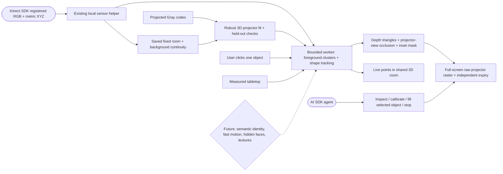

# Curved objects and slow movement — experimental v1

The existing Hardware page can select one separate object above a measured tabletop, estimate its visible shape from live Kinect depth, and paint that shape a solid color through a calibrated projector. It follows slow translation within a fixed camera-image area. The Studio 3D room shows the live selected points in the same metric frame as the saved room and table.

This is an implementation ready for physical qualification, not a claim of verified alignment on the Windows laptop. Calibration, tracking and output have been exercised with analytic geometry and actual browser workers/fullscreen pixels. Keep the first hardware test stationary, then move very slowly while watching the footprint.

## Setup in the existing interface

1. Pull the current repository and run **Setup Windows.cmd**. Start the Kinect helper and **Launch Preview.cmd**. Use Chrome with an extended desktop and the projector at its native resolution. Close Kinect Studio while testing to avoid competing acquisition/rendering work.
2. Secure Kinect and projector together. Disable automatic projector geometry changes. Keep the lens, focus/zoom, display resolution and mounting unchanged after calibration.
3. Place a matte cup or cylinder on the table, plus sizeable boxes at different depths across the projected area. Leave these in place throughout capture and calibration. A single flat surface cannot determine a full 3D projector model. The fit needs broad projected coverage and at least 10 cm of depth range.
4. In **Hardware setup**, connect the live Kinect and **Capture room reference**. Open the projection output on the projector and make it full screen. **Scan & map table**, selecting the correct measured patch if needed. Confirm the tabletop footprint physically.
5. In **Follow one object**, press **Calibrate projector in 3D**. It displays a fresh Gray-code sequence, fits the camera-space XYZ to projector pixels and checks unused correspondences. This fit belongs to this Hardware session, room reference, output window and exact viewport. It is not restored after a reload.
6. Click the middle of the object in the registered camera image. The object must be separate from other objects/hands, at least 3 cm above the measured tabletop, smaller than approximately 55 cm, and within the calibrated volume. The 36% × 36% camera-image box is a fixed tracking area, not a shape estimate.
7. Once status says **Tracking visible shape**, choose **Project color**, or ask the agent **“Make the selected object red.”** Move below 15 cm/s and keep it inside the outlined area. Physical lag depends on the whole laptop/display/projector chain; the software limit is not an accuracy guarantee.
8. **Clear color** restores the retained scene while keeping selection. **Stop tracking** clears selection and restores the scene. A missing/occluded/ambiguous target or sensor outage leaves the object output black until an explicit clear/stop. Re-select after loss; it will not automatically jump to a returning or similar object.

Capturing a new room retires previous calibration. Moving the object outside the tracking area or moving other large objects can invalidate the reference. After stopping tracking, a changed scene may need a new room capture and calibration. The original scene/assets are retained throughout.

## What is implemented

- **Calibration:** normalized 3D projective fit, robust sample consensus, separate held-out residual checks, nonplanarity/coverage gates, bounded calibration volume. Fits a pinhole model; does not estimate lens distortion or silently extrapolate outside the sampled volume.
- **Segmentation:** measured support-plane removal and connected metric neighbors. The clicked foreground component is the identity; no AI object detector or named-brand recognition.
- **Tracking:** one component, bounded centroid displacement/speed, initial shape/point-count checks, ambiguous-neighbor rejection and latched loss. It follows currently observed shape, not a persistent textured mesh or six-degree-of-freedom pose.
- **Rig continuity:** the fixed selected area may change; distributed background outside it must agree with the saved reference. This does not opt out the whole room from movement detection. Planar fill eligibility is suspended while an object region is active.
- **Projection:** all observed depth triangles participate in a projector-view depth buffer, including non-target occluders. Only confirmed target triangles inside calibration bounds are colored; silhouette/unknown cells are inset. Unseen occluders and hidden faces cannot be reconstructed from this one viewpoint.
- **Output:** object color is an exclusive black-backed raw raster, independent of the planar manual warp. Existing scene content stays mounted underneath. The output window independently expires stale masks; clearing explicitly returns to that retained scene. Black pixels are still subject to the projector's physical black level.
- **Performance:** only the newest available frame is considered, with one worker job in flight and no growing queue. Tracking/rasterization run away from the UI thread; the mask is at most 480 pixels wide. The current helper processes about 5 frames/second.
- **Timing:** source observations with age plus clock uncertainty over 500 ms, or clock uncertainty above 300 ms are rejected. Output masks expire at source timestamp + 650 ms − clock uncertainty (400 ms after the timestamp for the native helper’s conservative 250 ms uncertainty). A 500 ms runtime stall latches loss; a gap over 600 ms between tracker frames also rejects continuity. These are software bounds, not measured camera-to-light latency. A stalled renderer/OS/display can still hold its last displayed image; this is not a hardware interlock.
- **Agent:** existing Studio tools can inspect readiness, await 3D calibration, color the exact selected object ID or stop. It cannot choose seed coordinates, infer identity from a name or substitute coloring the table for coloring the object. Accepted commands do not prove physical illumination or registration accuracy.

## Deliberate limits and next work

The v1 target is one matte tabletop object with slow translation and a clear view from both Kinect and projector. Transparent/glossy objects, hands merging with the object, substantial rotation, large shape change, multiple similar objects, fast movement and moving rigs are not qualified. A near-identical replacement within the matching neighborhood can still fool geometric matching. Stop before exchanging objects; select the intended object again.

No semantic recognition, object pose/UV atlas, textured video on curved objects, hidden-side reconstruction, depth-camera fusion, predictive tracking or physical latency compensation is implemented. General 3D camera/projector calibration is new here; the older manually aligned surfaces remain supported separately. No promise is made to repair an intermittent USB connection through software.

Next useful hardware measurements: projected outline error at several heights, stationary edge stability, source-to-light delay, dropout blanking and a slowly moved cylinder. Those results should drive lens-distortion fitting, higher-rate acquisition and confidence thresholds before expanding to textured motion or several objects.

## Precedents and verification

[Microsoft RoomAlive ProCamCalibration](https://github.com/microsoft/RoomAliveToolkit/blob/master/ProCamCalibration/README.md) establishes the Kinect/projector Gray-code and 3D calibration approach, the need for non-flat calibration geometry, and live-depth projection updates. [PCL Euclidean cluster extraction](https://pointclouds.org/documentation/tutorials/cluster_extraction.html) provides the established plane-removal/connected-cluster pattern. This implementation is original TypeScript using the existing SDK point stream; it does not install or claim to run those engines.

Automated fixtures cover a ray-intersected cylinder/table, 3D fit and flat/inconsistent rejection, slow motion, occlusion/loss/stale timing, background movement and output expiry. The isolated browser fixture uses real workers and full-screen rendered-pixel assertions. It is available at `tests/object-mapping.html` on the separate 5175 test server only; production controls are integrated into the Hardware page. No physical Kinect/projector or user's scene/media is involved in that fixture.

Verification detail:224root tests and production/desktop build pass; the agent has144passing tests. The separate fullscreen object fixture passed the original16checks with native-like clock uncertainty. The expanded run passed15checks including blackout and explicit clear, then the in-app browser left fullscreen before the second selection; the changed viewport correctly blocked further projection. The full Hardware fixture projects/captures40 browser patterns and passed9checks of the actual host action/click/output flow; its long-run test uses explicitly simulated fullscreen status on the isolated test origin. Real fullscreen loss also aborted calibration as intended. Neither fixture is a physical sensor or optical test. On this Mac,30analytic256×192frames measured roughly36ms median/48ms p95 for segmentation plus mask rasterization alone; this excludes acquisition, transport, display and projector latency.
