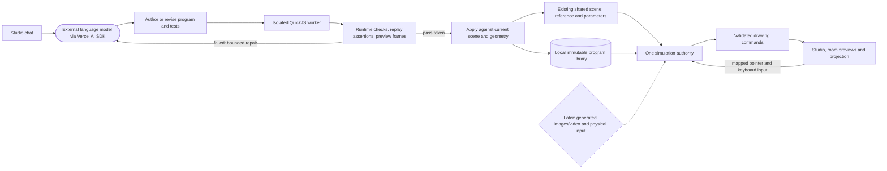

# Generated programs — first runtime release

The assistant can write original local 2D animations and pointer/keyboard games, test them offstage, and place them in the existing Studio. It is not limited to the Living art or Target game presets. Image/video generation, arbitrary shaders and measured hand input are separate next steps.

## Using it

1. Choose **Create with AI**, or ask in the existing chat: “Invent a glowing constellation game on the table where I connect stars by clicking them.”
2. The agent authors code and behavioral tests. The runtime executes the candidate separately and returns check results plus three rendered preview frames. Failed candidates can be repaired without changing the live room.
3. A passing candidate can be applied to the tested surface. It starts paused; the agent can then explicitly start it when animation or gameplay was requested. Existing content and calibration stay in place.
4. Open the asset in **Content** for **Start & interact**, **Pause**, **Reset**, named parameter sliders, test details, source, and **Restore previous version**. Click the artwork to focus keyboard/pointer interaction. **Arrange panels** returns to layout editing.
5. Ask for follow-up changes. Parameter-only edits preserve progress. Code revisions preserve placement, layer settings and compatible parameter values, reset their own game state, and start paused. Five previous versions remain available for rollback.

Use **Align full screen** and **Project full screen** as before. The same primitives feed surface layout, the 3D preview and projector output, with the existing surface/mask clipping. Input in the manual output is transformed back through its actual four-corner alignment before reaching the program.

## How it connects

Rectangles are custom software; the rounded node is an external model service; the cylinder is local storage; the diamond is future scope. QuickJS is the external open-source interpreter underneath the custom worker, budget checks and drawing interface.

## Execution and testing contract

- SDK1 source is a JavaScript expression returning `init`, `update`, `draw`. Persistent state is bounded JSON. Drawing uses rectangles, ellipses, lines, polygons, polylines and text, including arbitrary combinations, animation rules and game mechanics. This is not DOM/canvas scripting inside the Studio.
- Source runs inside QuickJS WebAssembly in a worker, without DOM, Node, filesystem, network, app controls, imports or audio bindings. The main renderer receives only validated drawing data. CPU interrupts, 16MB interpreter heap, bounded state/commands, and an outer worker watchdog stop failures.
- Tests include 31 initial frames, custom input replays/state assertions, and each exposed parameter's minimum and maximum. Each candidate has a total test time budget. Successful testing does not prove all future states, appearance quality, projector frame rate or physical accuracy.
- Pass tokens are local, short-lived, single-use, and bind the artifact hash, surface, scene revision and geometry revision. Changed scenes require retesting. Rejected operations leave the scene untouched.
- One Studio tab holds the simulation lock per origin. Other views consume the same state/frames and forward input. Runtime updates do not dispatch per-frame scene edits or scores. Closing the authority lets another control tab take over. An output-only window needs a Studio control tab open.
- Progress is checkpointed about once a second and on normal page exit, including the random sequence. Closing/crashing can lose the latest unsaved second. Simulations resume from saved progress without simulating elapsed offline time. Mutable closure variables are not saved; authors must keep persistent state in their JSON state object.
- Runtime faults retain the last valid frame and show an error in Content/agent inspection. Reset retries the current program; rollback restores an earlier tested version. Missing local artifacts are explicit errors, not silently recreated visuals.

## Storage and qualification

Program source/report artifacts are outside the canonical scene: browser local storage, or native `.local-data/programs.json`. Native progress uses `.local-data/program-progress.json`; browser progress is stored alongside that browser's program library. Libraries are device-local, currently bounded to 30 immutable versions. A scene/composition reference alone does not transfer source to another computer; export/sync and library management remain future work. No credentials or generated user assets are committed to GitHub.

The reviewed `tests/fixtures/generated-leprechauns.json` is a deliberate synthetic test fixture produced by a real model run, not user content. Other test fixtures exercise two procedural animations and a custom scoring game. The isolated browser fixture uses a fake scene bridge and its own local server, never the user's room or player.

Browser runtime/rendering, failure recovery and agent behavior have automated and isolated UI checks. Native storage/build paths are checked in code; interactive Electron/Windows, physical projector latency, prolonged multi-program load and GPU/context-loss recovery still require device qualification. QuickJS/worker isolation bounds ordinary generated code; it is not a claim that an interpreter or browser engine can never have a vulnerability.

SDK1 does **not** yet provide generated image/video APIs, imported textures inside programs, custom shaders, arbitrary 3D scene authoring, cross-surface game events, audio, networking, physics-engine bindings, or Kinect hand/body interaction. Existing YouTube/local media/backlight and measured planar workflows remain independent content paths.
