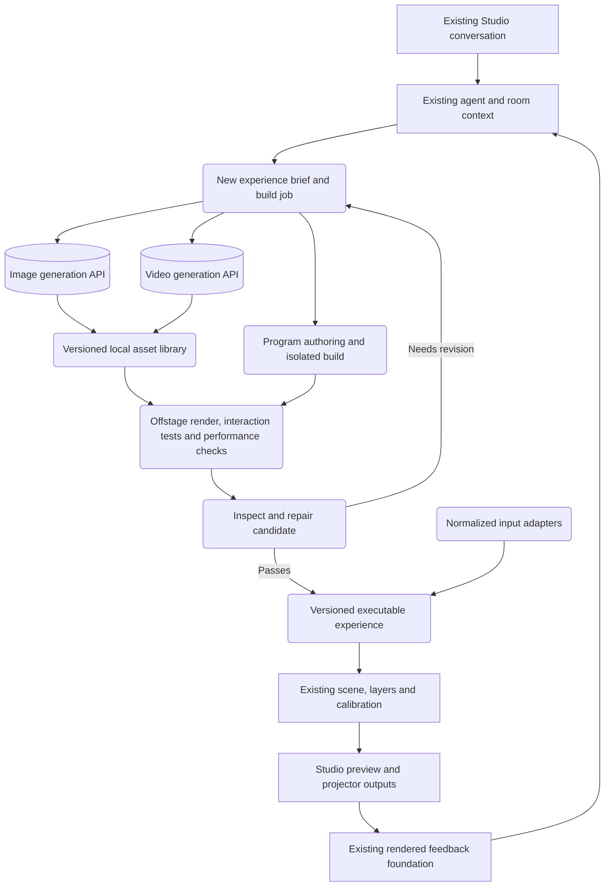

# Generative projection experiences

October 18, 2026. **Roadmap.** The first generated-program runtime and testing-loop slice is implemented; see [its release scope and limitations](GENERATED_PROGRAMS.md). Image/video integrations and the broader experience system below remain proposed.

The next initiative makes the existing Studio an environment in which the agent can author, test, revise and run original visual experiences. Image and video models supply visual assets; generated local programs supply animation, simulation and interaction. All three use the existing spatial scene and projection controls.

The product objective is creative breadth with dependable execution: a user describes an experience, gets a working version, and changes its appearance or behavior conversationally. This is a substantial expansion beyond choosing presets. It does not establish that every imaginable request will work on the first attempt, or that this combination has no precedents.

## First demonstration

“Make my table a bioluminescent garden. Give it original flowers and strange insects. Let me collect fireflies for points, and make successful catches send light up the wall. Give the wall a moving nighttime landscape.”

The system should produce generated image assets, an original local animation and game program, and a generated video background in one editable experience. First use mouse/touchscreen input; enable physical hand interaction only when a separately qualified sensor input adapter is available. A projected table is not automatically a touchscreen.

Then ask: “Make the insects avoid the cursor, add a two-player cooperative mode, and change the light trails to gold.” The second request must change behavior, rules and parameters while preserving placement and unaffected assets. Two players can initially use keyboard/pointer controls; body tracking is a distinct input option.

This demonstration is one acceptance case, not a new built-in garden preset. Held-out prompts must exercise unrelated content and mechanics.

## What we reuse

| Existing capability | Role in the initiative | Required extension |
| --- | --- | --- |
| Vercel AI SDK agent, typed commands and whole-request review | Understand requests, call tools, report completed and unresolved outcomes | Authoring tools, background jobs, artifact-based validation |
| Canonical scene, layers, alignment, masks and clean projection mode | Place and project accepted content without losing calibration | A generated experience content type and coherent multi-surface instances |
| Local image/video import and storage | Decode and display generated media once stored locally | Trusted provider-result ingestion, hashes, provenance and reusable library metadata |
| Rendered surface observations | Let the agent inspect its actual visual output | Offstage multi-frame previews and program/runtime evidence |
| Composition library and editable memory | Save arrangements and preferred styles | Versioned reusable experience packages, dependencies and additive insertion |
| Kinect measurements and registered data | Supply known geometry and future input evidence | Dedicated interaction adapters; current table mapping does not provide touch/gesture gameplay |

The current implementation in `src/shared/content.ts` contains four artwork presets and a fixed target game. `host/local-assets.ts` currently imports operator-selected files. `src/shared/studio.ts` exposes scene operations and single-surface observations, but no generation queue or executable-package runtime. Existing composition recall replaces the current composition; it must not be used to insert a new experience alongside existing content. Those are real new components, not capabilities unlocked merely by changing the system prompt. Voice is also still listed as unavailable by the agent; this initiative keeps a common request interface so a later voice adapter can use the same workflow.

## Overall flow

Rectangles represent existing foundations, rounded boxes represent new components, and cylinders represent external model services.

The model works at authoring speed. Local execution handles every animation frame, collision, score update and lighting response. Model calls do not sit in the gameplay loop.

## Three creation paths, one experience

### Original images

Generate and edit backgrounds, transparent cutouts, textures, sprites, illustrations and style references. Preserve alpha through storage and rendering; verify decoded transparency rather than accepting a painted checkerboard. Generate related assets from a common reference set. Draw precise text, timers, scores and controls in the renderer so editing them does not require another image generation.

Recommended initial supplier: the OpenAI image API, using a currently supported model selected by a small projection-specific comparison. Existing agent configuration makes this a natural first integration, but image access and billing must still be verified for the account. OpenAI documents generation, editing and transparent output; these are useful provider primitives, not a guarantee of exact masks or consistent characters. [Official image generation guide](https://developers.openai.com/api/docs/guides/image-generation), [image prompting guide](https://developers.openai.com/api/docs/guides/image-prompting).

### Original video

Generate scenic clips, moving textures and cinematic inserts asynchronously. Start from an approved style frame where useful. Import completed bytes into the local library, probe resolution/duration/decodability, and retain provider/model/job provenance. Playback then works without keeping a provider result URL alive.

Recommended first video adapter: Runway, followed by a Higgsfield adapter if its results or model access justify it. Runway documents text-to-video and image-to-video tasks. Higgsfield documents image/video endpoints and a submit/status/cancel workflow. Compare them using the same locked-camera, looping and irregular-surface briefs; do not infer projection quality from a provider's cinematic demo. Installing a Codex plugin alone would not connect these services to the shipped Studio agent. The application needs its own host-side API adapter and credentials. [Runway API guide](https://docs.dev.runwayml.com/guides/using-the-api/), [Higgsfield API](https://higgsfield.ai/higgsfield-api), [Higgsfield quick start](https://open.higgsfield.ai/quick-start).

Video is best for appearance that benefits from generated footage. It cannot deliver deterministic collisions or instantaneous rule changes. A claimed seamless loop must pass visual inspection and a temporal boundary check; crossfading can hide some cuts but may introduce ghosts, and reversing a clip is unsuitable for many motions. Transparent video is provider/codec dependent; use explicit masks or segmentation when needed rather than assuming every generated clip has alpha.

### Original animation and games

Have the coding model author a versioned program against a documented Projection SDK. The first SDK should include 2D drawing, sprites, paths, text, particles, timelines, simple scene geometry, material parameters, input events and state persistence. Build on the project's existing Three.js renderer instead of replacing the application with a second engine.

Use declarative composition for routine cases, plus an isolated code path for new behavior. A finite list of rules or animations would become another preset ceiling. Generated programs must be able to implement new simulations, state transitions, scoring and procedural geometry within the runtime's resource and capability limits. Extend reusable SDK primitives when repeated requests reveal a gap. The model may author shaders through a separately validated path; raw shaders must not be compiled in the operator interface.

Image assets and code can combine: generated butterfly artwork plus local wing animation, steering and collision rules; generated stone textures plus a procedural wall-fracture illusion; a generated landscape behind an interactive local foreground. A static image animated by code should be described accurately, not as a newly synthesized video clip.

## The experience package

Separate immutable authored material from a live instance. A package should contain:

- Stable identity, version, parent version, SDK/runtime version and authoring brief.
- Local asset references, hashes, generation provenance and a shared style description.
- Program or declarative source, entry points, bounded dependency list and build output hash.
- Surface roles, physical dimensions when known, local UV coordinates, world-space transforms and geometry provenance.
- Exposed parameters such as palette, density, speed, difficulty and duration, with UI control schemas.
- Required input capabilities, fallback controls and behavior on missing/stale input.
- State schema, seeded randomness, clock semantics and restart/migration behavior.
- Test scenarios, expected outcomes, runtime reports and preview samples.

A live instance owns parameter values, current state and surface bindings. New projector calibration changes output mapping, not the experience's artwork or game state. Recalling a package in another room resolves roles such as “table” against current geometry rather than copying old projector coordinates.

Retain the current five-content-items-per-surface convention. A multi-surface experience uses one visible instance entry on each affected surface, backed by one shared simulation. Its internal sprites and textures do not each consume an asset slot, but still count toward resource budgets. The inventory must expose the experience and expandable child layers so it never becomes hidden, undeletable background content.

## Projection belongs in authoring and final rendering

Provide the builder with usable surface polygons, exclusions, dimensions, normals, adjacency, current alignment, projector coverage where measured, and an optional designated viewer position. Mark simulated and estimated geometry explicitly. Use projected pixel density when calibration supports it to size text and game targets; do not invent physical precision from manual corners alone.

Author assets in surface UV or world coordinates. Apply clipping and final projector warping in the compositor, preserving transparent space around subjects. Do not ask an image generator to bake in the projector's trapezoid: a second downstream warp would distort it again.

For perspective illusions, distinguish the human's nominated viewpoint from the projector viewpoint. One viewpoint illusion will not automatically look correct from every position. Content on neighboring surfaces can share a world-space field and animation phase; distant or disconnected surfaces need an explicit transition, not an assumed physical connection.

One authoritative local simulation owns time, randomness, input and score. Studio previews and projector views render that state. Multiple independent games, one per projector window, would drift. Software synchronization is only part of multi-projector delivery: physical registration, brightness/black-level matching and display timing remain separate qualification work.

The compositor should make each permitted content source's actual frame available to lighting analysis, allowing generated images, clips and programs to use the existing backlight pipeline without screen sharing. This does not establish access to protected third-party video frames.

## Build, inspect, repair, activate

1. Convert the request into explicit outcomes, input requirements, surface roles and a resource/spend allowance.
2. Reuse suitable local assets and packages; generate only missing material. Return a job immediately and keep Studio usable.
3. Compile a candidate outside the live scene. Validate package structure, imports, parameters and dependencies.
4. Render sample frames over time and replay controlled input sequences. Collect runtime errors, frame pacing, memory estimates and state transitions.
5. Let the model inspect contact sheets or short previews and fix specific failures. Keep deterministic checks independent of the model's judgment. A plausible screenshot does not prove a game works.
6. Activate a passing candidate through the canonical scene path, preserving unrelated content. Revalidate current target bindings and user intent before applying a late result.
7. Keep the previous working version available for immediate rollback. A later refinement creates a candidate version instead of destructively rewriting the active experience.

Use a proposed default of three repair attempts, bounded by the configured time/spend allowance; tune it against evaluations. Routine parameter changes follow the existing immediate command path. A request for projection can activate automatically after checks within the configured budget; preview-only requests stay in preview. Do not introduce mandatory approval for every tool call.

Jobs need persisted provider request IDs, idempotency, retry/backoff, cancellation and restart reconciliation. Stopping a local poll does not necessarily stop provider computation or billing. Unknown submission outcomes must be reconciled before retrying a chargeable operation. Superseded/deleted targets must never receive late attachments. Long jobs must outlive an individual chat turn without leaving the chat blocked. Extend whole-request review with an explicit waiting-for-job outcome and durable completion events: submitted, generated, decoded, tested and placed are different states. The existing chat step/time budget must not be consumed by repeated status polling.

Add deterministic program-to-video export through this same job system, useful for preview, sharing and low-powered playback. This records an authored timeline and is distinct from model-generated footage. Portable experience export must include required assets/programs and runtime versions, not just scene references. Preserve provider provenance in both cases.

## Runtime boundary and performance

Generated code should never run inside the privileged app host or mutate Studio directly. Use a dedicated sandboxed runner with no Node access, filesystem access, credentials, navigation, arbitrary network calls or package installation. Exchange validated messages and approved asset handles through a narrow capability interface. Provider requests remain in the trusted host. Treat source, logs and generated artifacts as untrusted data when reviewing them. Provider-result ingestion must validate download destinations, file bytes and decoding before registration; do not expose arbitrary URLs or paths as agent tools. Electron documents process sandboxing, context isolation and controlled IPC; these need a tested application design, not just one enabled flag. [Electron security guidance](https://www.electronjs.org/docs/latest/tutorial/security).

Prototype the frame path before scaling the authoring system. Prefer validated render commands and assets for ordinary content; qualify a separate texture/frame route for programs requiring custom rendering. Reuse geometry/clock contracts, but do not put new effects through the existing JPEG YouTube capture path. Browser and native output adapters must declare their actual capabilities. A worker alone does not isolate a GPU driver fault, and an iframe or source-code scan alone does not establish safe execution. Timeouts, process recovery, bounded shaders/draw work and context-loss tests are release requirements.

Proposed qualification target: a representative 1080p composition at 30 fps on the friend's Windows laptop and this Mac, with responsive alignment while generation runs. Report measured p95 frame intervals and input-to-render latency, not only average FPS. A provisional local pointer-to-render goal is under 100 ms; physical input-to-photon latency must be measured separately. Begin with one build job and one code experience active, then qualify combinations up to the existing surface cap. Degrade optional effects or pause a failing experience rather than freezing Studio. No 60 fps or lossless interprocess-transfer claim until measured.

Keep all new media muted until deliberately enabled. One audio owner prevents doubled sound across preview/output windows. Microphone/music analysis and body/hand input require separate adapters, with source availability and confidence reported honestly.

## Delivery gates

| Gate | Deliverable | Proof required |
| --- | --- | --- |
| 1: Author a new executable experience | Package contract, isolated runner, SDK, offstage build/repair loop, generated-content item in the existing UI | Two unrelated animations and a game with a newly authored rule work without adding a preset to application code; deliberate infinite-loop/failure fixture leaves Studio recoverable |
| 2: Create and reuse visual assets | Image generation/editing, one video adapter, persistent jobs and library, style references | Actual provider-produced image and clip appear in the calibrated output; alpha, decode, cancellation, restart and late-result cases pass; no surprise audio |
| 3: Combine spatial behavior and interaction | One shared multi-surface simulation, exposed controls, game input/state and live version replacement | Garden demonstration works with pointer/keyboard; a follow-up changes mechanics; pause/save/reload/rollback preserve declared state; masks remain authoritative |
| 4: Qualify broad creation | Held-out prompts, performance/recovery tests and staged sensor input integration | Repeated runs on Mac/Windows; honest completion evidence; actual sensor input separately measured before claiming physical gameplay |

Gate 1 and provider plumbing can be built independently once their contracts are agreed. Finish one complete author→test→project path early. Do not spend the whole initiative wiring providers before proving generated executable content, and do not leave all video/game functionality to an unspecified later phase.

First release includes single-room, single-projector physical qualification plus multi-surface simulation. It establishes the shared state needed for later overlapping outputs. Full volumetric room effects, moving-object projection, automatic touch detection, arbitrary photorealistic rigged characters and measured multi-projector blending remain additional engineering/research tracks rather than hidden promises of this release. Optional 3D asset providers can be added behind the same package interface later.

## Evaluation and completion criteria

Use a small held-out suite across original stills, generated clips, procedural motion, interactive rules and combinations. Include a firefly collection game, a branching story, an audio-reactive visual using a supplied test signal, and a perspective illusion. At least one mechanic must be absent from authored examples. Test changes to mechanics separately from changes to theme.

Record first-attempt and within-budget success rates, authoring time, paid generation cost, repair count, visual acceptance, runtime errors and frame pacing. Do not invent a success-rate guarantee before collecting results. A model-generated test suite alone is insufficient: include fixed independent invariants and replay cases for scoring, collision, pause/resume and tracking loss.

Failure cases include provider interruption, missing assets, invalid imports, excessive draw work, invalid state migration, cancelled jobs completing late, stale geometry and device disconnect. Passing builds must retain the current working scene. Rendered evidence is software evidence; only physical projector tests establish the corresponding physical result.

Suggested product UI: use the existing conversation and Content inventory, with collapsible build progress, a preview, exposed controls and version history. Add a Library view for saved assets/experiences. Provider settings and spend limits belong in settings; source code and diagnostics are optional details. The projector continues to show only content.

## Ownership and first implementation task

Canvas owns package validation, shared contracts, local storage and host lifecycle, sandbox host, input/frame adapters, renderer integration, UI and output tests. Agent owns brief decomposition, authoring/provider tools, the creation-workflow coordinator launched by that host, reference/style planning, repair orchestration and completion evidence. Maintain one durable workflow rather than parallel agent/host job systems. The Content / Agent layer task reviewed this proposal's boundaries and confirmed the existing reuse and missing contracts. Exact new shared contracts must be agreed before implementation; this proposal does not alter the agent-owned architecture document.

The first coding task should deliver a generated-program vertical slice: introduce the package/instance contract and isolated runner, accept a model-authored program with editable parameters, exercise it offstage, display it as an ordinary Content item, and support one conversational revision with rollback. Pair it with a small representative Windows performance spike. Then add image/video jobs through the same package path.

Provider access, generation budgets and exact model selection remain configuration decisions for implementation. No new credentials, paid generations, dependency installations or live scene changes are part of this scoping task.
