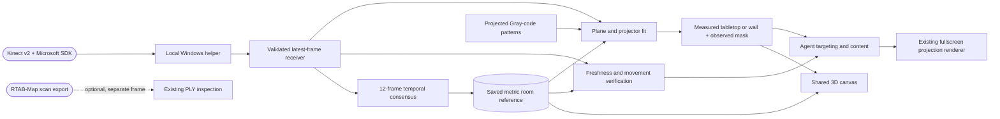

# Fixed-rig Kinect room integration · v1

The existing Studio now keeps a metric reference of the Kinect's visible room, shows it inside the same 3D canvas, and uses that reference when calibrating flat surfaces to the projector. It supports stationary tabletops and wall-like planar patches. It does not identify arbitrary objects by appearance or map curved/moving objects.

## Using it on the Windows laptop

1. Update this repository and run the normal Windows Studio updater/launcher described in [WINDOWS_SETUP.md](WINDOWS_SETUP.md). Use **Launch Preview.cmd** and Chrome for this Kinect workflow; native Electron helper access is not qualified. Update/restart the Kinect helper too. Use the powered Kinect v2 adapter and a direct compatible USB 3 connection. Check sustained acquisition with other capture/3D applications closed to reduce competing load.
2. Secure the Kinect and projector together. Keep vents clear and ensure both cameras can see the projected region. In Windows, extend the desktop to the projector; use its native resolution. Disable automatic geometry changes where possible, and leave zoom/keystone unchanged after calibration.
3. In **Hardware → Local Kinect / RGB-depth bridge**, connect to the helper. Choose **Capture room reference**. Keep the rig and scene still for the few seconds of collection.
4. Wait for **Live reference verified**. Studio's **3D room** now shows the measured cloud in meters. Unknown/unseen regions remain empty. Demo furniture and projector frusta are omitted from this measured view; simulated output views remain explicitly simulated.
5. Open the output on the projector and make it full screen. Choose **Scan & map table**. This projects the existing complementary Gray-code sequence, then solves measured plane geometry, projector matches and a conservative visible mask. A unique horizontal table-height plane can be applied automatically. If the floor is unavailable or several planes qualify, select the correct patch. A vertical patch can be assigned **Use as wall**.
6. Ask the agent **“Make the tabletop red.”** Inspect the real footprint on the first run. A numerical fit and the rendered preview cannot verify optical focus, projector processing or physical accuracy.

A saved room is local to this browser/app profile. Refresh restores it as unverified until fresh live observations match. It is not committed to GitHub or transferred by updating source code. Existing content is retained when capturing or forgetting a room. Calibration from an older room reference remains visible, but cannot authorize new physical fills until recalibrated.

## Data path

## What the new layer does

- Samples at most 12,000 depth rays per observation; twelve distinct observations span at least 1.5 seconds. Heavy aggregation runs in a worker. It stores no growing full-rate history.
- Retains rays measured in at least ten frames and consistent within 15 mm of their median; unstable or missing samples remain holes. XYZ and RGB are aggregated without smoothing across depth edges. These are initial engineering thresholds, not a Kinect accuracy specification.
- Freezes one camera-to-room coordinate basis. A consistent SDK floor estimate establishes up and height; otherwise orientation stays camera-relative and roles need manual selection. Subsequent plane fits use the same basis rather than reorienting the room with every frame.
- Keeps a bounded point cloud and geometric witness in IndexedDB. Repeated observations improve this one visible view; they do not reconstruct unseen geometry or merge a moving camera's views.
- Verifies returning observations against saved depth and XYZ. Three distinct fresh matches are required after interruption; two seconds without fresh observations removes eligibility. Detected movement or sensor-mode changes latch invalidity until a new room capture. Small/local changes below the thresholds can escape detection; this is not continuous object tracking or a safety interlock.
- Retries transport interruptions with bounded backoff. The helper also has bounded native acquisition recovery. Each acquisition boundary invalidates pending calibration/recording continuity; a partially captured stripe sequence must be retried, never spliced across the gap.
- Keeps already-rendered content visible during a dropout. New physical fills require current room/reference/sensor/output eligibility, checked again immediately before application. Clearing a fill remains available offline. It does not automatically blank existing projection when objects move.

Mounting the Kinect above the lens preserves a rigid relationship; it does **not** measure that relationship. This v1 estimates a projector mapping separately for each observed plane. It does not yet recover a general 3D projector lens model. Changing projector settings or moving only the projector cannot be detected by a fixed Kinect depth view; recalibrate after either.

## Precedents used and limits

- **Microsoft RoomAlive / ProCamCalibration**: inspected upstream commit `51a39f18ccff15699cf5c3a35111774ccbb0287c`. Its [calibration source](https://github.com/microsoft/RoomAliveToolkit/blob/51a39f18ccff15699cf5c3a35111774ccbb0287c/ProCamCalibration/ProCamEnsembleCalibration/ProjectorCameraEnsemble.cs) accumulates repeated depth frames and rejects uncertain pixels before projector calibration. Our implementation uses bounded temporal consensus, an explicit fixed reference and the existing Gray-code/plane solver; no upstream binary or source was copied into the app.
- The [RoomAlive calibration guide](https://github.com/microsoft/RoomAliveToolkit/blob/master/ProCamCalibration/README.md) separates depth/color registration from projector calibration and explains why full projector intrinsics need non-planar calibration geometry. That is the next step for general 3D objects and movable rigs.
- **Microsoft Kinect SDK** supplies calibrated camera-space XYZ and RGB/depth registration. Its [coordinate-mapping documentation](https://github.com/Kinect/Docs/blob/master/Kinect4Windows2.0/k4w2/Programming_Guide/Coordinate_mapping.md) defines these spaces. Device identity and availability are not evidence of an unchanged pose.
- **PCL** supplies the established [RANSAC planar segmentation precedent](https://pointclouds.org/documentation/tutorials/planar_segmentation.html). Our current solver already uses geometric plane fitting plus connected observed coverage; a horizontal patch is a tabletop candidate, not semantic recognition of a particular object.
- **RTAB-Map** remains the optional upstream route for mobile RGB-D odometry and reconstruction, using the [Kinect mapping workflow](https://github.com/introlab/rtabmap/wiki/Kinect-mapping). The existing PLY adapter remains separate because its reconstructed world must be registered to this rig before projection. See [RTABMAP_INTEGRATION.md](RTABMAP_INTEGRATION.md).
- **OpenRoomAlive** offers an [open-source C++ projector/camera architecture](https://github.com/OpenRoomAlive/OpenRoomAlive). It is a useful reference for later multi-unit registration, not an installed dependency of this v1.

## Qualification and next work

Automated checks cover analytic metric geometry, noisy/missing rays, movement, saved-frame validation, reconnect boundaries, stale/replayed frames, source replacement, and physical-action guards. An isolated browser fixture exercises the actual room capture worker, local persistence, Hardware UI, same-canvas rendering, reconnection and movement latch. Agent/helper checks include a real-model scan → map → fill workflow against isolated synthetic ports. These are not physical calibration results.

Still requires Windows hardware qualification: sustained USB acquisition, native driver restart, projector pattern latency/contrast, floor estimate reliability and measured footprint error. Start with a matte, clear tabletop. If USB repeatedly cuts out, investigate power, adapter/cable/controller and host load; retaining a reference cannot manufacture missing observations.

Next milestones: general projector intrinsics/extrinsics using multiple depths, per-surface local change masks, object-instance segmentation and curved geometry, sensor-driven interaction, camera-motion registration/TSDF fusion, and multiple-rig timing/brightness/blending. No claim of arbitrary-object or whole-room autonomous understanding is made by this slice.

## Curved-object extension

The experimental [curved-object and slow-movement workflow](CURVED_OBJECTS_V1.md) now builds on this fixed-room reference. It adds full 3D projector fitting, explicit object selection and live solid-color masks. The planar workflow above remains unchanged; semantic recognition, hidden faces and fast tracking remain future work.
