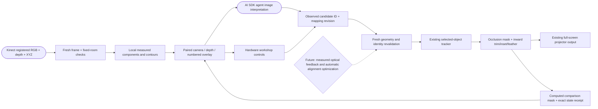

# Object mapping workshop — experimental v1

The existing **Hardware setup → Inspect and refine edges** card and the agent use the same measured-object workflow. The Kinect supplies a paired registered color/depth observation. Local geometry code finds separate foreground objects above the mapped tabletop. The agent can choose one of those numbered candidates and adjust its light boundary, then inspect the resulting settings and computed mask.

This extends [curved objects and slow movement](CURVED_OBJECTS_V1.md); it does not replace that workflow’s calibration, fixed-rig checks or tracking limits. It is ready for physical qualification, not a claim of verified Windows/Kinect/projector accuracy.

## Use it

1. Complete the room capture, tabletop mapping and **Calibrate projector in 3D** steps in the curved-object guide. Keep the same projection output full screen, with the Kinect and projector rigidly mounted.
2. Place a separate matte object above the measured table. Keep it still while choosing or refining it. Click **Inspect camera & objects** to see the current camera image, registered depth and numbered measured candidates.
3. Select the intended numbered object, or ask the agent to inspect the camera and select the intended candidate. If several candidates could match, identify the number rather than relying on a brand or object name. Selection alone does not enable projected color.
4. Use **Project color**, or ask **“Make the selected object red.”** Check the physical footprint.
5. Ask **“Inspect the selected object, inset the edge by two mask cells, feather it inward by three cells, then inspect the result.”** Alternatively edit the controls in the same Hardware card. Directional trims remove a percentage of the object’s current camera-space bounds; inset removes a border in projector-mask cells; feather fades inward from that border.
6. Use **Undo edge change** or **Reset edges** to compare. Each accepted change requires a new inspection before another edit. The manual card refreshes its observation after an accepted change; the agent performs the same inspect/change/inspect loop.
7. **Clear color** restores the retained scene. **Stop tracking** clears the selected object and session edge settings. Re-select after tracking loss. Calibration and adjustments are session-only.

At a 1920-pixel-wide projector raster, one of the 480-wide mask’s cells spans approximately four raster pixels. The interface shows the current scale. Inset accepts 1–8 cells, feather 0–8 cells, and each directional trim 0–30%. These are conservative clipping controls, not full-resolution subpixel alignment controls. Aggressive settings can remove all light from a small object; undo or reset restores the earlier footprint when tracking remains valid.

## What the images mean

| View | Evidence |
| --- | --- |
| Camera | Physical registered RGB from the selected source exposure. |
| Registered depth | Depth from that exposure; near red, far blue over 0.2–5 m, missing data black. |
| Numbered outlines | Computed measured components over the RGB image. The mask preserves observed holes; the contour is the exterior boundary. |
| Projector mask | A computed visibility/edge preview. Gray shows inward feathering. **It is not a photograph of projected light or proof of optical alignment.** |

Candidate names are not recognition guarantees. The agent can interpret the supplied images and select an observed candidate ID; it cannot supply invented seed coordinates, enlarge a silhouette into unknown pixels, or treat an accepted command as physical proof that the result looks optimal. Observe actual spill or misregistration on the object before deciding the next adjustment. Projector pose/zoom/keystone errors require calibration rather than progressively clipping an incorrect fit.

## Connection to the shared system

No new helper process, cloud vision service, native protocol or sensor driver is required. Inspection is on demand rather than continuous image upload. The current configured agent receives the requested camera/depth/overlay images when its inspection tool runs. Source observations and local masking remain grounded in metric sensor data; the model does not generate the geometry.

## Freshness and scope

- An inspection token expires after 15 seconds and is consumed by a successful edit. Exact mapping revision, room, sensor connection, support surface and projector calibration must still match.
- Source freshness is independent: exposure age plus clock uncertainty must be at most 500 ms, with uncertainty at most 300 ms. The host obtains a new frame before acting. A 15-second token never makes a 15-second-old frame usable for projection.
- Selection re-matches current measured geometry and checks it again when tracking starts. Refinement preserves the same selected object and fixed background witness area. Movement over one centimeter since inspection requires another inspection; continuous tracking retains its existing stricter loss/ambiguity checks.
- New settings immediately retire the previous mask. Output resumes only with a newly processed mask for those settings. Concurrent changes prevent a stale operation from reporting another operation’s result as its own.
- Undo retains up to ten edge settings for the selected object. Reset uses conservative defaults and is itself undoable. Neither restores an old object identity or calibration.
- The agent is bounded to four mapping changes and six mapping inspections per request. It must inspect after changes and report unresolved optical evaluation honestly.
- This remains one separate tabletop object, observed faces, solid color and slow translation. It does not add textured curved video, hidden-face reconstruction, general object pose, fast motion, several tracked objects or self-correcting projector calibration.

## Verification

The root regression suite has 231 passing tests and the production/desktop build passes. The workshop’s analytic browser fixture passes 16 assertions using real workers and actual rendered canvas pixels, with explicitly simulated fullscreen status. It checks paired images, grounded selection, exact result revisions, smaller/feathered footprints, consumed-token rejection, undo/reset, fresh-frame movement rejection, disconnection and black output on loss. The full Hardware fixture also passes 16 assertions through 40 projected/captured calibration patterns, the actual HardwareWorkspace and Studio port, selected color output, candidate selection, refinement, post-inspection and undo. That long fixture explicitly simulates fullscreen status. Direct UI selection and inset/feather application were checked visually. Separate existing fixtures cover actual browser fullscreen; see the curved-object guide for their scope and limitations. The agent owner reports 157 offline checks/build and four actual OpenAI scenarios against synthetic camera data: refinement, undo, image-grounded selection plus refinement, and refusal after disconnection.

These tests do not exercise a physical Kinect, Windows USB/GPU performance, real projector optics or source-to-light latency. Start stationary on the friend’s hardware, inspect the projected boundary, try one small edge adjustment, undo it, then test slow movement and a sensor interruption. Preserve the fixed rig and return to calibration if the physical footprint is displaced.
