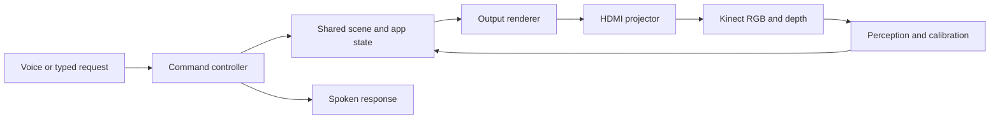

# Projection assistant: v1 software blueprint

Prepared October 12, 2026. This is the architecture and build backlog. The timer, spatial canvas, content library, and typed assistant milestones are implemented; see the updates at the end and `README.md`. Hardware validation is still pending.

**Content scope update:** [CONTENT_ARCHITECTURE.md](CONTENT_ARCHITECTURE.md) records the expanded first-prototype scope: immersive surfaces/worlds, custom generated motion games, utility displays, YouTube, and the spatial agent/canvas contract. The agent works in a persistent 3D room canvas whose surface-bound operations inherit calibrated constraints; routine edits have a direct local path without a model placement-review loop. That document supersedes this blueprint's narrower initial content list and blanket deferral of generated games. The geometry and hardware discussion below remains background context. Current implementation status is recorded separately from the proposed scope in that document.

## Starting point

- Purchased: Futuzen Android projector and Xbox One Kinect (Kinect v2). Exact projector revision and its automatic adjustment behavior remain unverified.
- Host: existing Apple Silicon Mac. Node/npm and Xcode are available. `cmake` and `pkg-config` were not found on the current shell path. The current `python3` points into an unrelated project's virtual environment; create a dedicated environment for this project.
- Workspace: initially an empty Git repository. The first software milestone has since been built; see `README.md` for launch instructions.
- Kinect requires its PC adapter, external power supply, and USB 3 data connection. Adapter inclusion has not been confirmed.
- First target: one projector, one camera, one stationary flat wall or table at a time. The rendering and app architecture should later support multiple visible surfaces within the same projector footprint.

## Product hypothesis and first demo

The hypothesis is that a voice-controlled assistant can make physical surfaces useful as displays without requiring the user to operate projection software. The integration to build is a shared model of surfaces, calibration, apps, and user intent, plus reliable execution and recovery.

Camera/projector calibration and interactive projection have established precedents. Microsoft's [RoomAlive Toolkit](https://github.com/microsoft/RoomAliveToolkit) includes projector/Kinect calibration and interactive projection components. Its C#/Direct3D components are architectural references, not a turnkey Mac foundation. This plan makes no claim of patent novelty or an exhaustive competitive search.

First hardware demo:

1. Select or name a flat surface.
2. Say, “Put a five-minute timer on the table.”
3. See a readable timer fit that surface.
4. Say, “Move it left,” “Make it bigger,” and “Pause it.”
5. Switch to a recipe card or animated artwork without recalibrating.
6. Deliberately invalidate calibration and recover without losing the timer or recipe state.

Use names such as `table` and `wall` initially. “Put it here” requires a separate selection signal, such as a click or a reliably observed pointing gesture. Voice alone does not identify a physical location.

## Proposed implementation

Use Electron with React/TypeScript for the desktop app, app state, voice command execution, and projector output. Use Python/OpenCV for perception and calibration, with a small C++ capture helper linked to libfreenect2 for the Kinect. Keep the capture helper behind an adapter so it can be replaced without changing apps.

Start with two windows: an operator window on the Mac and an output window that can initially appear on the same display. Later place the output window on the projector using Electron's [display APIs](https://www.electronjs.org/docs/latest/api/screen). Calibration coordinates must use actual output pixels and explicitly account for macOS display scaling.

For flat surfaces, render trusted HTML, Canvas, and video components inside a common projective transform. A planar CSS `matrix3d` warp is a practical first implementation; graphics can use Canvas/WebGL inside that panel. Do not assume every remote webpage can be converted into a WebGL texture. Mesh warping and arbitrary 3D surfaces are a later rendering path.

Use Electron IPC within the desktop app and a localhost protocol for the vision service. Small events can use JSON/WebSockets. RGB/depth frames need binary transport or shared memory with timestamps and bounded queues, not enormous JSON arrays. Process the latest available frame rather than accumulating delay.



The physical feedback path is projected light observed by the camera. Depth alone cannot observe an internal projector keystone change.

## Modules and boundaries

| Module | Reuse | Build for this product |
|---|---|---|
| Sensor adapter | libfreenect2 RGB/depth acquisition and registration | Stable frame format, device health, timestamps, recordings, replay, reconnect behavior |
| Geometry service | OpenCV calibration, homography estimation and structured-light primitives | Surface selection, calibration workflow, quality checks, versioning and invalidation |
| Scene store | Normal application state and persistence | Named surfaces, app placement, selection, calibration confidence, shared coordinate conventions |
| Renderer | Browser layout, Canvas/WebGL, media playback | Warp, clip and arrange apps into calibrated surfaces; keep operator UI separate |
| Command controller | Schema validation and normal application logic | Tools that voice, buttons and keyboard all call; meaningful errors and idempotent execution |
| Voice adapter | Existing speech/voice API | Supply scene context, request actions through tools, and speak actual execution results |
| App registry | Templates and established media APIs | Shared create/update/pause/resume/dispose contract, placement preferences and supported actions |
| Interaction service | Optional hand landmarks and depth processing | Map observations to surface coordinates; hover/dwell/select events and confidence filtering |
| Diagnostics/recovery | Logs and local persistence | Explain misalignment, replay failures, and restore apps after recalibration |

Rendering, timers, and input processing remain local and deterministic. A language model chooses actions; it does not calculate every animation frame, tick a timer, or directly invent calibration matrices.

## Shared data contracts

These are proposed contracts, not existing endpoints.

- `SensorFrame`: timestamp, sequence, sensor mode, RGB/depth payload references, depth validity, intrinsics, and the relationship between color and depth coordinates.
- `Surface`: stable ID, user label, plane pose if known, boundary, usable region and confidence. Use meters for physical geometry and normalized `(u,v)` coordinates for app layout. Simulated/manual surfaces may lack metric dimensions and must say so.
- `Calibration`: ID/version, camera/projector modes, transform for each surface, validation error, observation timestamp and status (`uncalibrated`, `calibrating`, `ready`, `suspect`, `lost`). Keep transform direction explicit.
- `AppInstance`: ID, kind, surface ID, bounds in surface coordinates, configuration, persistent state and supported actions.
- `InputEvent`: source, timestamp, surface ID, normalized coordinates, phase and confidence. Mouse and hand input share this contract.
- `CommandResult`: request ID, success/error, updated scene version and affected app IDs. Retried requests must not accidentally create duplicate apps.

Initial tools:

```text
list_surfaces()
select_surface(surface_id)
calibrate_surface(surface_id)
create_app(kind, surface_id, config)
move_app(app_id, bounds_uv)
update_app(app_id, changes)
perform_app_action(app_id, action, args)
close_app(app_id)
```

Example intent execution:

```json
{
  "request_id": "request-001",
  "tool": "create_app",
  "args": {
    "kind": "timer",
    "surface_id": "table-1",
    "config": { "duration_seconds": 300, "label": "Pasta" }
  }
}
```

The controller checks that the surface exists, calibration is usable, and the requested app supports those parameters. Placement policy finds room inside its usable region. The voice assistant receives success only after the app is created. If two timers are present, “pause it” uses explicit selection or asks which one.

## Geometry build order

1. **Manual flat-surface calibration.** Select four ordered corners on a camera preview or adjust the projected quad directly. Compute a planar homography. This unlocks app work while automatic calibration is unfinished. It does not prove arbitrary 3D mapping.
2. **Automatic projected-pattern calibration.** Project known points/patterns; capture corresponding positions in the Kinect RGB camera. Fit a transform from more than four points and evaluate separate validation points. Depth supplies surface geometry; it does not by itself reveal where projector pixels land. OpenCV provides [homography/calibration primitives](https://docs.opencv.org/4.x/d9/d0c/group__calib3d.html) and [Gray-code projector/camera correspondence tools](https://docs.opencv.org/4.x/d1/dec/classcv_1_1structured__light_1_1GrayCodePattern.html).
3. **Depth-assisted surface discovery.** Fit planes to valid depth, associate RGB/depth coordinates, and let the user choose and name a usable rectangle. Start with empty, matte surfaces and controlled lighting. A fitted infinite plane is not a detected physical tabletop boundary.
4. **Calibration recovery.** Detect changes using observable RGB reference points or brief probe patterns; depth can help detect moved surfaces or hardware. Distinguish occlusion from persistent geometric drift. Pause spatial input when uncertain, recalibrate, then restore the same app state.
5. **Generalized 3D mapping.** Add projector intrinsics/extrinsics, meshes, depth-aware occlusion and nonlinear correction only when the planar path works.

Keep projector processing fixed during each pattern sequence. Allow unknown display latency by holding patterns long enough and validating captured frames. If automatic features keep changing the image, restart or fall back to manual calibration; continuous arbitrary changes cannot be assumed recoverable without interruption.

A fixed camera/projector mount makes calibration more repeatable, but it does not eliminate the need to observe a new surface or detect changes in the projector's internal processing. Optical blur and projection shadows cannot be repaired by geometric warping.

## Content and interaction

Build four reusable app types before adding more:

- **Timer:** locally maintained deadline/paused duration, persistent state, pause/resume/reset; timer timing must survive slow AI responses and renderer interruptions.
- **Recipe:** validated structured steps and ingredients rendered by a readable template, with next/back and optional speech.
- **Art:** existing local images plus a few animated Canvas templates; generated assets load asynchronously with a placeholder and cancellation.
- **Simple game:** one local game using the shared input contract. First use mouse/keyboard; later use hand hover/dwell or gestures.

YouTube is another adapter using its [IFrame Player API](https://developers.google.com/youtube/iframe_api_reference). Start with a supplied video URL, then add search separately. Respect embedding and playback restrictions; arbitrary websites, commercial games, and DRM video do not all expose the same integration surface. Do not assume a cross-origin player can be drawn into a canvas. Planar HTML embedding is a distinct path from texture-based rendering.

The Mac sends the final rendered display over HDMI. There is no need to upload every asset to the projector's Android storage.

For hands, start with large targets and hover/dwell. [MediaPipe Hand Landmarker](https://developers.google.com/edge/mediapipe/solutions/vision/hand_landmarker) can provide RGB image landmarks. Combine those with registered Kinect depth and a measured surface plane where depth is valid. Its inferred “world landmarks” are not automatically calibrated room coordinates. Test overhead hand views and occlusion explicitly. Precise physical touch and fast gesture games are separate milestones, not promised Kinect features.

## Voice implementation

Start with typed commands and a push-to-talk button using the Mac microphone and speakers. Typed commands and voice must execute the same tools.

A speech-to-speech service such as OpenAI Realtime can supply the conversational interface. Its [function tools](https://developers.openai.com/api/docs/guides/realtime-mcp) let the app execute local actions and return results. Keep the provider behind an adapter and leave model selection/configuration explicit at implementation time.

Give the model compact scene context: surface labels, selected app, current app states and available actions. Send imagery only when a task needs it; do not send raw depth video to a language model on every frame. Keep provider credentials outside renderer content. Delay wake words, continuous listening, and echo/interruption tuning until push-to-talk is reliable. API usage will be a separate runtime cost.

## Kinect on this Mac

[libfreenect2](https://github.com/OpenKinect/libfreenect2) provides RGB, IR/depth and registration, includes Mac build instructions, and requires USB 3. Its documentation warns about virtual-machine USB limitations. The presence of Mac instructions is not a guarantee for this Mac's current OS, USB adapter and driver combination.

The practical Apple Silicon diagnostic option is [FreenectTD](https://github.com/stosumarte/FreenectTD): it documents Kinect v2 RGB, depth and registration on Apple Silicon/macOS 12.4+ with TouchDesigner 2025+, but is experimental and does not provide skeleton tracking. Use it as a sensor diagnostic or temporary bridge if useful. It is not a standalone Python package.

The proposed reusable app remains Electron plus a vision service. If direct C++ capture integration stalls, continue app work in simulation while using FreenectTD to isolate whether hardware capture works. Avoid building two complete rendering stacks. TouchDesigner is also a valid alternative for a mostly visual installation, but its [Non-Commercial edition limits resolution to 1280×1280 and has usage restrictions](https://docs.derivative.ca/Licensing); assess the license before adopting it as the product runtime.

## Work before delivery

### First development session

- Create the Electron/TypeScript app with operator/output windows and a simulated named surface.
- Implement the scene store and validated command controller.
- Add a grid, timer and recipe card; commands work through buttons/typed input.
- Add draggable corner calibration and clipping on the simulated output.
- Save/reload scene and app state.

Acceptance: create a timer, resize/move it, switch content, and restore it after restarting. No camera/projector or cloud connection is needed for these checks.

### Second development session

- Add the voice adapter and push-to-talk, after configuring API access.
- Add art and a simple game template through the same app registry.
- Add a mock sensor, synthetic planes and mouse-generated hand events.
- Simulate changed calibration, a lost sensor, duplicate commands and delayed voice responses.
- Prepare the Kinect build/diagnostic path in an isolated environment.

Acceptance: the complete timer demonstration works on the Mac screen, and injected calibration failure pauses spatial input without resetting the timer. These are ordering suggestions, not a promise that all integrations take exactly two days.

## First sessions with hardware

1. Validate Kinect RGB and depth separately before attempting calibration. Record a short synchronized sample and device/mode metadata for replay.
2. Validate HDMI output, actual resolution, focus and stable projector geometry. Record how automatic adjustment behaves.
3. Manually map one planar surface; verify a grid and large buttons at center and edges.
4. Add automated correspondence detection and validation. Report error across held-out points; do not report fitting residual alone as accuracy.
5. Test hand interaction only after geometry is stable. Measure false triggers and input-to-display latency.
6. Test controlled movement, automatic projector adjustment, temporary occlusion, disconnection and recovery.

Candidate first-demo targets to tune after measurement: readable content across the chosen surface, approximately 5–10 mm placement accuracy for large UI elements, and an uninterrupted 20-minute session. These are engineering targets, not predictions of this hardware's performance. Rendering smoothness, voice latency, sensor processing latency, and total interactive latency should be measured separately.

## Likely hard parts and later decisions

The highest initial risk is Kinect capture on the specific Mac/adapter combination. After that come repeatable calibration, mapping a pointing/hand observation to the intended surface, and recovery from changing projection geometry. Speech, timers and template-based content are comparatively straightforward integration work.

Defer simultaneous room-wide mapping, precise fingertip touch, general 3D objects, arbitrary generated executable apps, unattended third-party app control, and motorized projector aiming. Software cannot aim this fixed projector at a wall and a separate table outside its optical footprint. Repositioning remains a physical step.

Revisit the renderer when curved surfaces or arbitrary captured applications become necessary; revisit hardware when measured brightness, blur, latency, driver reliability or shadows limit the demonstrated use case. Keep sensor, voice and content providers replaceable through the contracts above.

## Implementation update · first coding milestone

The first software prototype is now implemented. Run `npm start` or double-click `Launch Studio.command` to open the Electron studio and projection output. It includes a simulated flat surface, manual four-corner perspective alignment, a test grid, draggable/resizable timers, start/pause/reset controls, shared commands, and local persistence. See `README.md` for usage and validation details. The architecture above and the expanded `CONTENT_ARCHITECTURE.md` remain the roadmap; voice, Kinect, and automatic calibration have not yet been implemented.

## Implementation update · spatial canvas foundation

Version 0.2 adds a shared simulated 3D room with a tabletop and clipped wall, native drawable boundaries/exclusions, surface-attached timers, a world-space procedural ripple, an orbitable editor, an independent fixed viewer, and two simulated projector views. Moving a surface carries its content; projector changes recompute sampled visibility and nominal overlap weights. A single persisted effect clock and timer state feed all views. Legacy scenes migrate without losing timer identity, bounds, deadlines, or the manual quad.

The manual single-surface adapter remains available for the purchased projector. Its corners do not establish metric room calibration. Geometry is simulated, overlap brightness is nominal, and display timing is not hardware synchronized. Sensor acquisition and physical calibration remain the next hardware work.

The authoritative v2 Scene/Command/Snapshot/CommandReceipt types are released for the separately owned agent package. Accepted commands return actual resolved placements. The agent package has implemented its initial six tools against this interface; main/preload chat transport and a studio chat UI are a separate integration milestone, not part of this canvas release. See `coordination/canvas-status.md` and `agent/INTEGRATION.md` for the handoff.

Validation: 25 shared tests and the production build pass. Browser checks cover orbit, independent viewer, native exclusion handling, timer reassignment, surface movement, projector enable/disable, manual save restoration, and live clean-output switching. Physical hardware and this revision's native display behavior still need validation. Open the browser preview at `http://127.0.0.1:5173/` or use the launch instructions in `README.md`.


## Implementation update · content and conversational assistant 0.3

Schema v3 adds notes, recipes, procedural artwork and a pointer target game to the existing timers. A shared content registry defines configuration, runtime actions and output support. All render paths use the same state; foreground placement avoids occupied space and native exclusions. Moving content preserves runtime state. Game hits and scores remain local.

The separately owned Vercel AI SDK package now has fourteen typed tools bound to the imported Scene/Command contract. Browser and Electron hosts bind its conversation to their existing authoritative scene interface, with no second scene store. The studio's Ask assistant/AI panel supports typed requests, follow-up context, progress, cancellation and conversation clearing. Secrets stay in the host process. Browser transport is private local Vite HMR; desktop transport is isolated IPC. This does not deploy a Vercel web service.

Validation: 46 app tests and production build pass; the agent package reports 28 passing tests. Live browser tests verified an AI edit and follow-up changed rendered note content, cancellation preserved scene state, and clear conversation kept the room. Manual browser tests exercised recipes, art, notes, a completed game and clean output. Kinect, voice, media playback, automatic calibration and physical display behavior remain pending. Desktop chat IPC is implemented/typechecked but was not exercised in the visible Electron app during this milestone.
