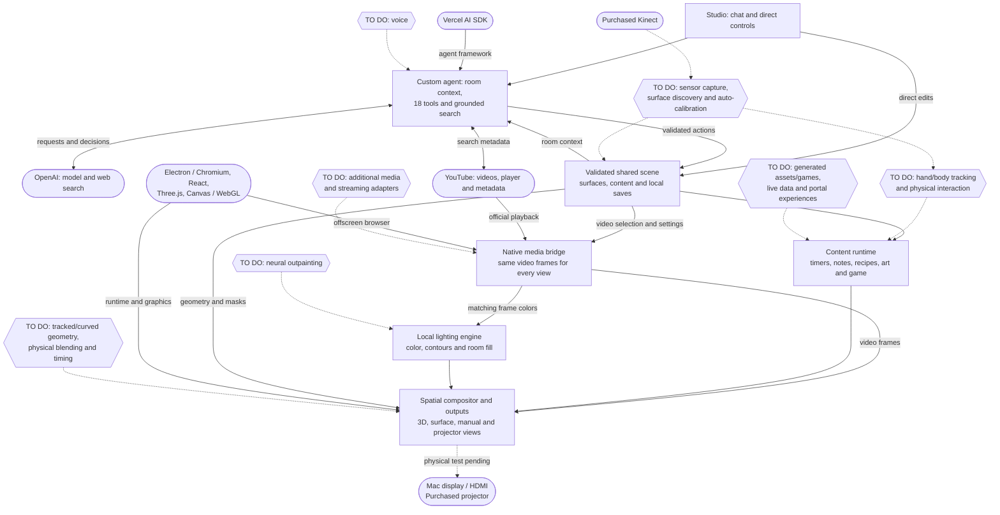

# Projection Mapper — software and integration briefing

Status: October 13, 2026. Based on current source and the latest canvas/agent milestone notes. This is an implementation inventory, not a claim that every item in the product architecture has shipped.

The prototype now connects a conversational agent, a persistent spatial scene, several content types, native YouTube rendering and a local video-lighting engine. Its main custom contribution is making those parts share the same surface geometry, content identity, playback source and controls.

The working software is ahead of the physical installation: room geometry is simulated, and Kinect acquisition and automatic projector calibration remain pending. The latest recorded verification is 97 root tests plus build and 64 agent tests plus typecheck/build, with actual muted YouTube playback and matching light observed across the simulated wall and table. These checks were completed during the implementation milestone; they were not rerun for this briefing.

## Custom software already built

| Area | What we built | Boundary of the current capability |
| --- | --- | --- |
| Spatial studio | Operator interface, 3D room view, surface layout, content inspector, four-corner manual alignment and clean output views. | Manual alignment is available; it does not measure the room. |
| Shared room and scene | Named surfaces, world/local coordinates, outlines and exclusion holes, viewer/projector poses, attached content and validated commands. Content follows its surface. | Geometry is currently simulated. The agent reads structured scene context, not a live Kinect scan. |
| Content runtime | Timers, notes, step-by-step recipes, procedural animated art, a pointer target game and YouTube panels. Common timing and state across views. | Artwork uses implemented presets; games currently use one implemented mechanic. General image/video/game generation is pending. |
| Layout and persistence | Move/resize, overlapping panels, five assets per surface, background reuse, saved scene state and migrations. | The cap limits assets, not how many times the agent may edit them. Browser and desktop stores are separate; there is no cloud sync. |
| Agent integration | Custom room context, prompts, 18 tool schemas, validated dispatch, bounded conversation history, cancellation and action receipts. | The external model chooses actions; local code validates and executes them. The agent does not render frames or calculate calibration. |
| YouTube discovery | Topic search, grounded candidate selection, URL/ID validation, metadata checks and reuse of existing players. | Discovery uses external search and YouTube metadata. A search result does not guarantee that its video permits embedding. |
| Native media bridge | One isolated offscreen official player per video instance, source lifecycle, frame delivery, playback state, pointer forwarding, retry and reconnect. The localhost studio receives it through a private local transport. | Currently implemented for YouTube. Native playback supplies pixels without screen sharing. New sources start paused and muted; Play is muted until explicit unmute. |
| Video lighting | Local edge/interior color analysis, black-bar and bright-outlier handling, temporal smoothing, tone profiles, bounded contour continuation and a continuous light field. | This is conventional image processing and geometric extrapolation. It does not infer unseen objects through a neural outpainting model. |
| Room-wide composition | Video, content and light share surface coordinates. Room fill extends the same light field across surfaces; masks protect timers, foreground panels and native exclusions. | Intensity, spread, smoothing, tone, opacity, vibrance and room fill are adjustable. Coverage on a real wall/table still depends on projector reach. |
| Output and reliability | Perspective transforms, simulated coverage/occlusion and nominal overlap blending; native window/display plumbing; private host messages, credential isolation and regression tests. | Physical color matching, black levels, hardware timing and automatic alignment are not established by the simulator. |

The 18 agent tools cover room inspection, YouTube search, timer creation/control/attachment, effects/grid, note/recipe/art/game creation, YouTube placement and lighting, and generic content update/control/attachment/removal. There is no tool that grants arbitrary code execution or supplies invented calibration matrices. Video playback remains an explicit operator action.

## What external systems supply

| Supplier or foundation | Supplied capability | Our integration |
| --- | --- | --- |
| OpenAI hosted services | Language reasoning, text generation and web search. | We assemble scene context, define the tools, ground video selection and apply validated results. Model/search calls require internet and API usage. |
| Vercel AI SDK and its OpenAI provider | Agent loop, model/tool protocol and provider plumbing. | These are libraries in our local host. Using the SDK does not mean the app is hosted on Vercel. |
| YouTube | Video catalogue, hosted video, official iframe player and oEmbed metadata. | We search/select/embed, manage the source and route its rendered frames into the projection compositor. |
| Electron, Chromium and Node | Desktop process/window runtime, browser engine and offscreen frame delivery. | We built the source lifecycle, local transport, mute behavior and connection to scene rendering. |
| React, Three.js, Canvas and WebGL | UI and graphics foundations. | We built the spatial model, masks, layout, effects and lighting composition on those foundations. |
| TypeScript, Zod, Vite and build/test tools | Types, schema validation and development infrastructure. | Our domain contracts, validation rules and tests are project-specific. |
| macOS, Mac/GPU, HDMI and purchased projector | Display output and physical light. | The intended hardware path is Mac-rendered frames over HDMI. Assets do not need uploading to the projector's Android storage. Physical validation remains pending. |
| Purchased Xbox One Kinect | RGB/depth sensing hardware. | No working sensor connection is integrated into the app yet. |

Official references: [Vercel AI SDK](https://ai-sdk.dev/docs/introduction), [Electron offscreen rendering](https://www.electronjs.org/docs/latest/tutorial/offscreen-rendering), and [YouTube iframe API](https://developers.google.com/youtube/iframe_api_reference).

Continuous animation, timers, composition and video-color analysis run locally. The AI is called for requests and content decisions, not for every video frame. Current video frames are not sent to the language model. YouTube itself remains an online media source.

## Scoped work that remains

| Workstream | Existing foundation | Still to develop or verify |
| --- | --- | --- |
| Voice | Typed conversation already reaches the correct tools. | Microphone input, speech recognition/synthesis or realtime voice, push-to-talk, then interruption/echo handling and possibly wake words. |
| Kinect capture | Sensor-independent room model and simulated geometry. | Mac/USB driver validation; synchronized RGB/depth acquisition, registration, health and recording/replay. libfreenect2 is a candidate, not an installed app integration. |
| Automatic calibration | Manual four-corner alignment and spatial transforms. | Projected calibration patterns, detected correspondences, measured projector pose/lens parameters, surface discovery, independent error checks, drift detection and recovery. OpenCV is a proposed foundation. |
| Physical interaction | Pointer game and surface attachment. | Hand/body tracking, camera-to-room mapping, hover/dwell/touch confidence and dance/pose scoring. Candidate landmark libraries are not wired in. |
| Generated assets and games | Typed content contracts and working templates. | Image/video provider adapters, generation jobs, local asset lifecycle, coherent style, declarative game rules, pose sequences and validation. General portals and generated worlds are also pending. |
| Live information | Extensible content architecture. | Weather/location, authenticated calendar/task connectors and their on-surface widgets. |
| Additional media | Native source abstraction and shared lighting/compositor. | Local-file/general-app/service adapters and service-specific playback support. Netflix and other protected streaming are not integrated; offscreen rendering alone does not establish DRM compatibility. |
| Advanced visual extension | Local contour/color continuation. | Learned, temporally coherent outpainting, if pursued. The current reference-inspired effect is an approximation rather than reconstruction of unseen scenery. |
| Advanced spatial rendering | Distinct viewer/projector poses and simulated overlap. | Tracked viewer perspective, curved or moving surfaces, physical multi-projector calibration, measured color/brightness/black-level correction and hardware synchronization. |
| Real hardware acceptance | Clean output, manual alignment and simulator tests. | Actual HDMI resolution, stable keystone/focus, physical coverage, readability, shadows, total latency and a sustained session on the purchased projector and Kinect. |

The [libfreenect2 project](https://github.com/OpenKinect/libfreenect2) is one proposed external sensor foundation. Its availability does not establish compatibility with this particular Mac and USB setup.

## System flow

Rectangles identify implemented custom software. Rounded capsules identify externally supplied services, libraries or hardware. Hexagons identify scoped work still to do. Solid arrows show implemented software connections or dependencies; dotted arrows show planned connections or physical validation still pending. Hardware being purchased does not mean its integration is complete.

## Where the custom value sits

A request such as “put a forest video on the wall and extend its colors across the room” combines external reasoning/search and YouTube playback with our own validated placement, persistent room state, native frame bridge, local lighting and spatial output. The same source frame supplies both the visible video and its surrounding light, while other content retains its state and readable area.

This integration is the core of the prototype. External services supply powerful individual capabilities; our software connects them into one controllable spatial environment. It does not establish that no other product uses similar techniques.

Implementation references: [canvas status](coordination/canvas-status.md), [agent status](coordination/agent-status.md), [content architecture](CONTENT_ARCHITECTURE.md), [prototype plan](PROTOTYPE_PLAN.md), `src/shared/`, `src/contentPainter.ts`, `src/SpatialView.tsx`, `electron/media-sources.ts`, `host/vite-media.ts`, and `agent/src/`. Current code and latest status notes supersede historical milestone descriptions in older planning sections.
